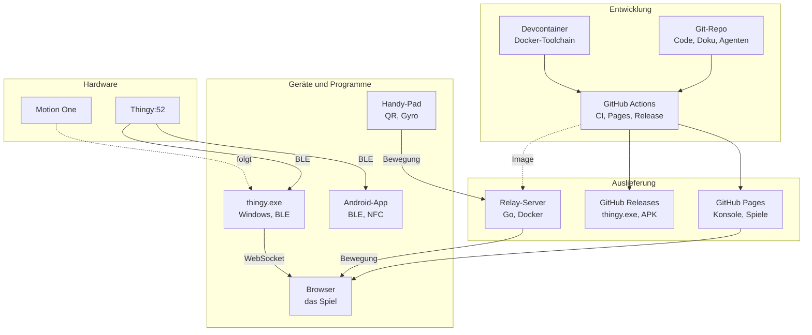
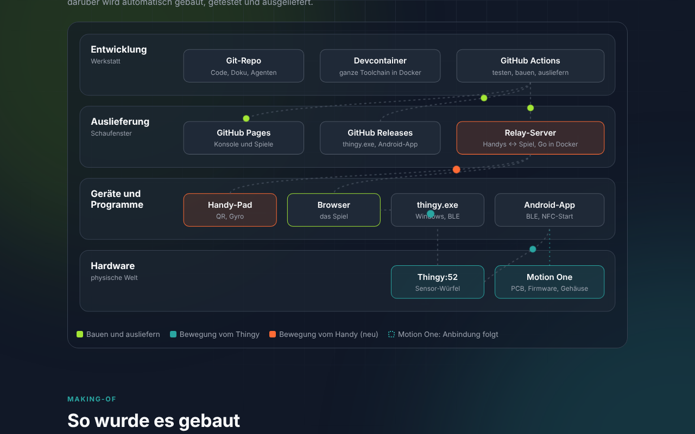

# disroop Playground

**Die Spielkonsole, die KI gebaut hat.** Spiele, die man mit Bewegung steuert: per Handy, mit dem Sensor-Würfel
Thingy:52 oder mit unserem eigenen Controller Motion One. Gebaut von KI-Agenten, von der Leiterplatte bis zum
Spiel. Alle Werkzeuge laufen in Docker und CI.

> KI baut nicht nur Software. Sie kommt in der physischen Welt an. Die Spiele sind der Köder, die durchgehende
> Kette Hardware → Firmware → Funk → Software → Spiel ist der Beweis.


## In einer Minute spielen

- **Im Browser:** [Startseite auf GitHub Pages](https://stefaneicher.github.io/disroop-sensor-playground/) → Ski oder Tennis, mit der Tastatur.
- **Mit dem Handy:** Den Relay-Server starten (`./project relay image && ./project relay run`), das Spiel mit `?relay=same` öffnen und den QR-Code scannen. Handys brauchen HTTPS, siehe [relay/README.md](relay/README.md).
- **Mit dem Thingy:52:** `./project play` (oder `--sim` ohne Hardware), siehe [docs/THINGY.md](docs/THINGY.md).

## Die Konsole

| Konsole | Im Repo |
|---|---|
| Gehäuse, Menü | [`console/`](console/): Startseite |
| Spielkassetten | [`games/`](games/): Tennis, Ski; gemeinsame Eingabe in `games/src/input/` |
| Controller | Tastatur, Handy (`games/src/pad/` + `relay/`), Thingy:52 (`hardware/thingy-bridge/`, `hardware/android/`), Motion One |
| Online-Dienst | [`relay/`](relay/): verbindet Handys mit dem Spielbildschirm |
| Zubehör | [`hardware/`](hardware/): Thingy-Bridge, Android-App, Motion One |

Alle Controller liefern dasselbe Bewegungsformat (`MotionFrame`, [docs/protocol.md](docs/protocol.md)). Den
Spielen ist egal, woher die Bewegung kommt.

## Systemlandschaft





Die Startseite zeigt dieselbe Landschaft animiert. Was noch fehlt (Hosting des Relays, Deploy, Betrieb):
[docs/KONZEPT_LANDSCHAFT.md](docs/KONZEPT_LANDSCHAFT.md).

## Ordner

```
console/                Startseite (GitHub Pages und Relay)
games/                  Spiele im Browser (TypeScript + three.js, kein Bundler)
  src/input/            Eingabe: Bridge/App-Verbindung, Handy-Modus (relay.ts, phone.ts), Kalibrierung, Gesten
  src/tennis/ src/ski/  die Spiele
  src/pad/              Handy-Controller-Seite
relay/                  Go-Server: Handys ↔ Spielbildschirm, liefert auch die Website aus (Docker)
hardware/
  thingy-bridge/        Go: thingy.exe (BLE, Telemetrie, TUI, HTTP/SSE, Lied, NFC); web/ = Dashboard
  android/              Android-App (Kotlin, Compose)
  shared/               chorus.json (Lied), telemetry.example.json
  motion-one/           Eigener Controller (PCB, Firmware, Gehäuse); Stand: hardware/motion-one/management/RESUME.md
project, scripts/       CLI: ./project <bereich> <befehl>
.devcontainer/          Toolchain-Image (Go, Node, JDK, Android SDK, Chromium)
docs/                   Protokoll, Architektur, Anleitungen, Konzepte
```

## Entwickeln

Lokal wird ausser Docker nichts installiert (Windows 11 mit WSL2 und Docker in WSL).

```bash
./project image          # Devcontainer-Image bauen (einmalig)
./project test           # alle Tests: bridge, web, games, relay, android
./project games test     # nur die Spiele
./project relay test     # Relay: Go-Tests + Smoke mit Bildschirm und Pad im headless Chromium
./project build          # thingy.exe und Android-APK
```

Mehr: [docs/DEVELOPMENT.md](docs/DEVELOPMENT.md), [docs/ARCHITECTURE.md](docs/ARCHITECTURE.md), Übersicht in [docs/index.md](docs/index.md).

## Konzepte

- [docs/KONZEPT_PLAYGROUND.md](docs/KONZEPT_PLAYGROUND.md): Framing als Spielkonsole, Publikum, Ordner, Umbenennung, Präsentation
- [docs/KONZEPT_HANDY_CONTROLLER.md](docs/KONZEPT_HANDY_CONTROLLER.md): Handy per QR-Code, Skicross bis 20 Spieler
- [docs/KONZEPT_LANDSCHAFT.md](docs/KONZEPT_LANDSCHAFT.md): Systemlandschaft, was fehlt

## So wurde es gebaut

Ein Mensch gibt die Richtung vor, KI-Agenten in festen Rollen bauen (Systems, Firmware, Leiterplatte, Mechanik,
Docs & Media, siehe [.github/agents](.github/agents)). Fortschritt und Entscheide stehen in [JOURNAL.md](JOURNAL.md),
[TODO.md](TODO.md) und [IDEEN.md](IDEEN.md).

Für Firmen: [disroop.ch](https://disroop.ch)
