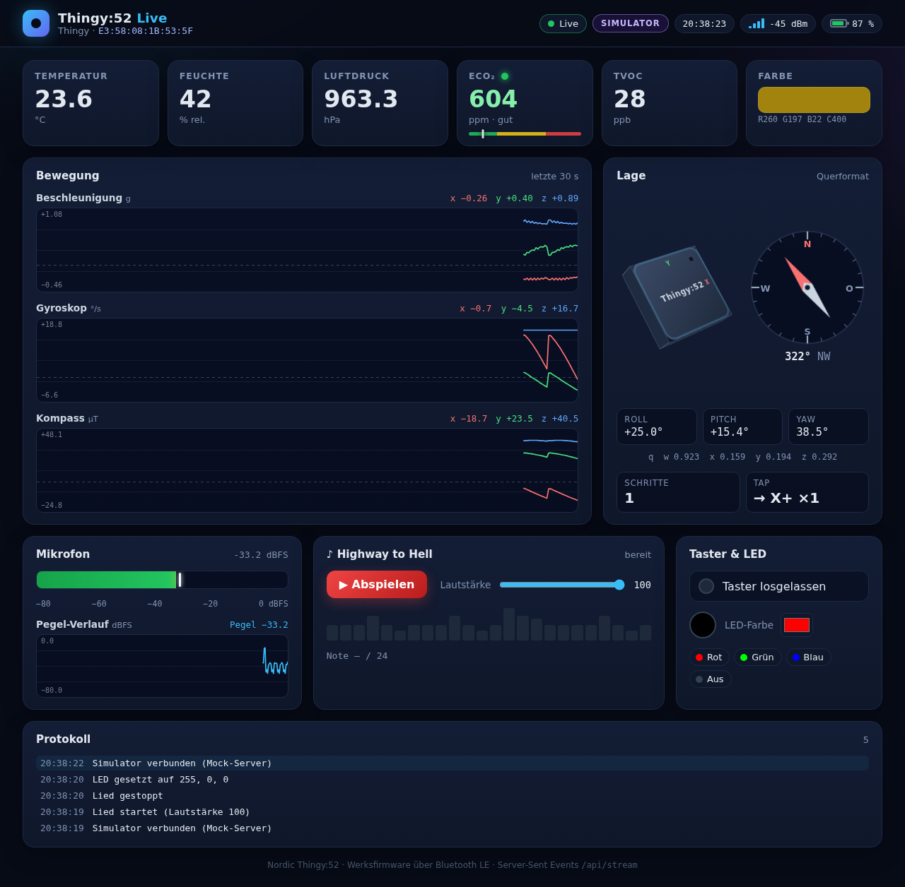
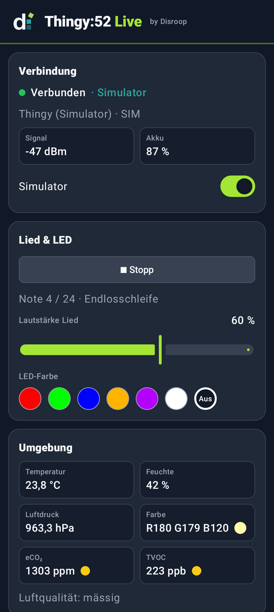
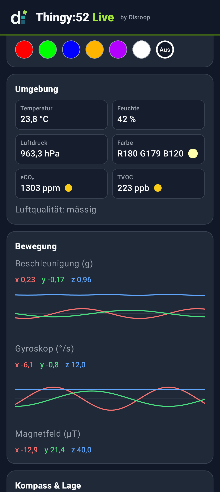
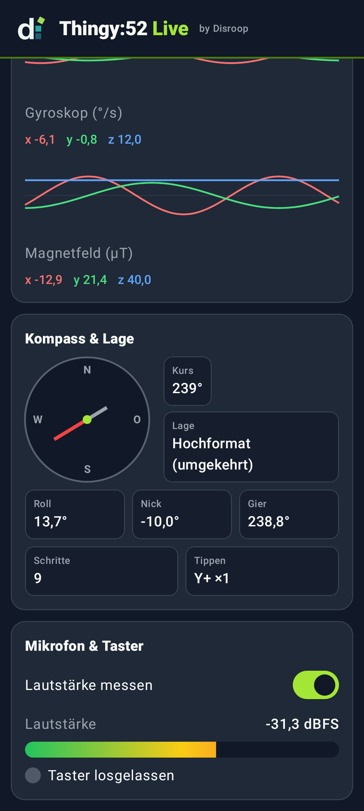
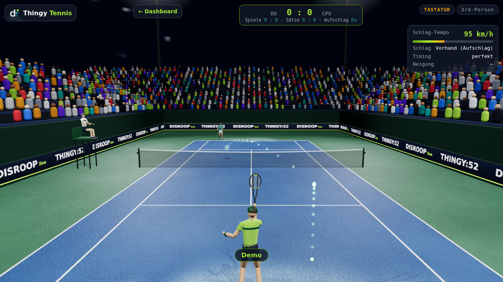
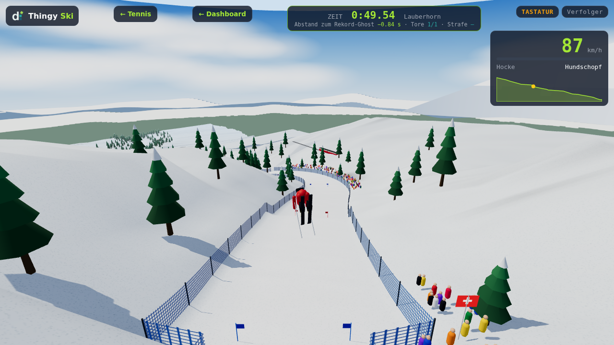

# disroop-sensor-playground

**Ein kleiner Sensor-Würfel wird zum Gamecontroller:** Der Nordic Thingy:52 schickt seine Sensordaten per Bluetooth live an ein Dashboard. Er dient als Tennisschläger, und auf der Lauberhorn-Abfahrt lenkst du damit den Skifahrer.

> **Was ist der Thingy:52?** Ein etwa 6 × 6 cm grosses Entwicklungsboard von Nordic Semiconductor im Gummigehäuse. Es enthält einen nRF52832-Chip mit Bluetooth LE und NFC, eine Bewegungseinheit (Beschleunigung, Gyro, Kompass), Temperatur-, Feuchte- und Luftdrucksensor, Gas- und Farbsensor, Mikrofon, Lautsprecher, eine RGB-LED und einen Taster. Foto und Datenblatt: [Nordic Thingy:52 – Produktseite](https://www.nordicsemi.com/Products/Development-hardware/Nordic-Thingy-52), [Werksfirmware auf GitHub](https://github.com/NordicSemiconductor/Nordic-Thingy52-FW).

Das Projekt hat drei Teile. Der Thingy läuft dabei immer mit der **Werksfirmware**, Flashen ist nicht nötig.

### 1. Sensorübersicht mit Verwendungszwecken

Alle Sensorwerte laufen per Bluetooth LE live ins Terminal, in ein Web-Dashboard und in eine Android-App. Zu jedem Sensor erklärt das Dashboard, wofür man ihn braucht (ⓘ). Der Thingy spielt dazu „Highway to Hell“, die LED blinkt mit.


*Web-Dashboard im Simulator-Modus (`thingy.exe --sim`). Mobile-Ansicht: [docs/img/dashboard-mobile.png](docs/img/dashboard-mobile.png)*

  

*Android-App im Simulator-Modus. Die Bilder erzeugt `./project android screenshots`.*

### 2. Tennis



*Tennis im Browser, der Thingy ist der Schläger: `thingy.exe tennis` (live) oder `thingy.exe tennis --sim`. In der Android-App über „🎾 Tennis“. Mehr in [docs/TENNIS.md](docs/TENNIS.md).*

### 3. Skiabfahrt



*Abfahrt auf Lauberhorn und Streif, der Thingy ist der Lenker: kippen = lenken, Nase runter = Hocke, Ruck = Sprung. http://127.0.0.1:8052/ski oder in der Android-App über „⛷ Ski“. Mehr in [docs/SKI.md](docs/SKI.md).*

> **Keine Firmware, kein Flashen, kein Debugger.** Für dieses Projekt wird keine Firmware gebaut. Der Thingy läuft unverändert mit der Nordic-Werksfirmware (v2.x). Unsere Software ist ein reiner **BLE-Client**:
> - **Empfangen:** Sie abonniert die GATT-Notifications des Thingy (Sensordaten) und dekodiert sie.
> - **Senden:** Sie schreibt Befehle in GATT-Characteristics: Ton für das Lied, LED-Farbe, Sensor-Intervalle, NFC-Inhalt.
>
> Das hat Grenzen: Es geht nur, was die Werksfirmware anbietet. So ist z. B. die Mikrofon-Abtastrate fest auf 16 kHz. Deshalb ist die Lautstärkemessung standardmässig aus, sie würde die BLE-Verbindung überlasten.
>
> ```
> Thingy:52 (Werks-FW) ──BLE──▶ thingy.exe (Windows) ──▶ Terminal + Web-Dashboard :8052
>                      ──BLE──▶ Android-App ch.disroop.sensorplayground (direkt, Start per NFC)
> ```

## Features

- **`thingy.exe`** (Go, Windows): verbindet sich per BLE mit dem Thingy und zeigt alle Werte live im Terminal:
  - Beschleunigung, Gyro, Kompass, Kurs, Euler-Winkel, Lage, Tippen, Schritte
  - Temperatur, Feuchte, Luftdruck, eCO₂/TVOC, Farbe
  - Mikrofonpegel, Taster, Akku, RSSI
- **Web-Dashboard** auf http://localhost:8052. Es ist in die exe eingebettet und bekommt die Daten live per Server-Sent Events. Es zeigt Charts, 3D-Lage und Kompass, und du kannst damit das Lied und die LED steuern.
- **Lied:** „Highway to Hell“ (Refrain, 24 Noten) über den Thingy-Lautsprecher. Die LED-Farbe folgt der Tonhöhe. Starten und stoppen geht per Taster am Thingy, im Dashboard oder in der App.
- **NFC:** `thingy.exe nfc` schreibt einen Android Application Record auf den NFC-Tag des Thingy. Hältst du das Handy an den Thingy, öffnet sich die App.
- **Android-App** `ch.disroop.sensorplayground`: verbindet sich direkt per BLE und zeigt dieselben Werte. Sie hat einen eingebauten Simulator.
- **Tennis** (`games/src/tennis/`, eigenes Programm): Tennis-Spiel mit three.js, der Thingy ist der Schläger. Schwung = Schlag, Neigen = laufen. Die Bridge liefert die Bewegung mit 100 Hz per WebSocket und spielt das Spiel unter `/tennis/` aus. Ohne Thingy mit Tastatur oder im Simulator spielbar. Dazu **Ski** (`games/src/ski/`): Lauberhorn und Streif in 3D, siehe [docs/SKI.md](docs/SKI.md).
- **Simulator** (`--sim`) für Demos, Tests und CI ohne Hardware.
- **Alles im Docker-Devcontainer:** Lokal wird ausser Docker nichts installiert.

## Quickstart

**Voraussetzungen**
- Windows 11 mit WSL2 (Ubuntu) und Docker in WSL
- Bluetooth-LE-Adapter unter Windows
- Thingy:52 mit Werksfirmware, geladen. Zum Aufwecken den Knopf drücken.

**Im Repo-Ordner unter WSL:**

```bash
./project image          # Devcontainer-Image bauen (einmalig, dauert einige Minuten)
./project build          # build/thingy.exe, build/thingy-linux, build/disroop-sensor-playground-debug.apk
./project bridge run     # thingy.exe auf Windows starten: Terminal-Live-Ansicht + Web-GUI
```

Dann im Browser http://localhost:8052 öffnen. `Strg+C` beendet die exe.

**Ohne Hardware:** `./project bridge run --sim` startet die exe mit dem Simulator.

**Tennis:** `./project play` (echter Thingy) oder `./project play --sim` baut alles, startet `thingy.exe tennis` und öffnet http://127.0.0.1:8052/tennis/. Mit dem Invoke-CLI: `./t tennis.play [--sim]`. Anleitung: [docs/TENNIS.md](docs/TENNIS.md).

> Die exe läuft über WSL-Interop **unter Windows**, weil WSL kein Bluetooth hat. Der Port lauscht nur auf `127.0.0.1` von Windows. Aus WSL brauchst du deshalb `curl.exe` statt `curl`, siehe [Troubleshooting](docs/TROUBLESHOOTING.md).

## Android-App installieren

1. APK bauen mit `./project android build`. Das ergibt `build/disroop-sensor-playground-debug.apk`. Ein GitHub-Release mit fertiger APK ist geplant, siehe [Releases](https://github.com/stefaneicher/disroop-sensor-playground/releases).
2. Installieren:
   - **Sideload:** APK aufs Handy kopieren, öffnen und „Unbekannte Apps installieren“ erlauben.
   - **adb (Windows):** `adb install -r build\disroop-sensor-playground-debug.apk`
3. Beim ersten Start die Berechtigung „Geräte in der Nähe“ (Bluetooth) erteilen.

Die APK ist mit einem öffentlich eingecheckten Demo-Schlüssel signiert. Neuinstallationen über lokale und CI-Builds hinweg funktionieren deshalb. Für den produktiven Einsatz ist sie nicht gedacht.

## NFC: Handy an den Thingy halten

```bash
./project bridge nfc             # Backup nach build/nfc-backup.hex, dann AAR "ch.disroop.sensorplayground" schreiben
./project bridge nfc --restore   # Original-Inhalt (Nordic-App) aus dem Backup zurückschreiben
```

Der Thingy nimmt nur **eine** BLE-Verbindung an. Während `nfc` läuft, müssen `thingy.exe` und die App getrennt sein.

## Projektstruktur

```
console/                Startseite (Landingpage auf GitHub Pages)
games/                  Spiele im Browser (TypeScript + three.js, kein Bundler); die exe liefert sie unter /tennis/ aus
  src/input/            Eingabe: Verbindung zur Bridge/App, Bewegungsframes, Kalibrierung, Gesten (Schwung)
  src/tennis/           Tennis
  src/ski/              Ski (Lauberhorn, Streif)
  src/common/           Gemeinsames (FPS-Anzeige, Texturen)
hardware/
  thingy-bridge/        Go: thingy.exe (BLE, Decoder, Telemetrie, TUI, HTTP/SSE, Lied, NFC); web/ = Dashboard
  android/              Android-App (Kotlin, Compose) + reines Kotlin-Modul :protocol
  shared/               chorus.json (Lied), telemetry.example.json (Beispiel-Snapshot)
  motion-one/           Eigener Controller „Disroop Motion One“ (PCB, Firmware, Gehäuse); Stand: [Resume](hardware/motion-one/management/RESUME.md)
project, scripts/       CLI: ./project <befehl>, ruft scripts/<bereich>.sh auf (bridge, web, games, android)
.devcontainer/          Toolchain-Image (Go, Node, JDK 21, Android SDK, Chromium)
docs/                   Protokoll-Vertrag, Schema, Architektur, Anleitungen, Konzepte
build/                  Build-Ausgaben (nicht im Git)
```

## Dokumentation

Die Übersicht findest du in [docs/index.md](docs/index.md):

- [Architektur](docs/ARCHITECTURE.md)
- [Bedienung](docs/USAGE.md)
- [Entwicklung](docs/DEVELOPMENT.md)
- [Troubleshooting](docs/TROUBLESHOOTING.md)
- [Protokoll-Vertrag](docs/protocol.md)
- [Tennis](docs/TENNIS.md)
- READMEs der Bereiche: [bridge](hardware/thingy-bridge/README.md), [web](hardware/thingy-bridge/web/README.md), [tennis](games/README.md), [android](hardware/android/README.md)

## Lizenz

© 2026 Stefan Eicher. Alle Rechte vorbehalten, siehe [LICENSE](LICENSE). „Highway to Hell“ ist hier nur als grobe Tonfolge des Refrains enthalten (`hardware/shared/chorus.json`).
