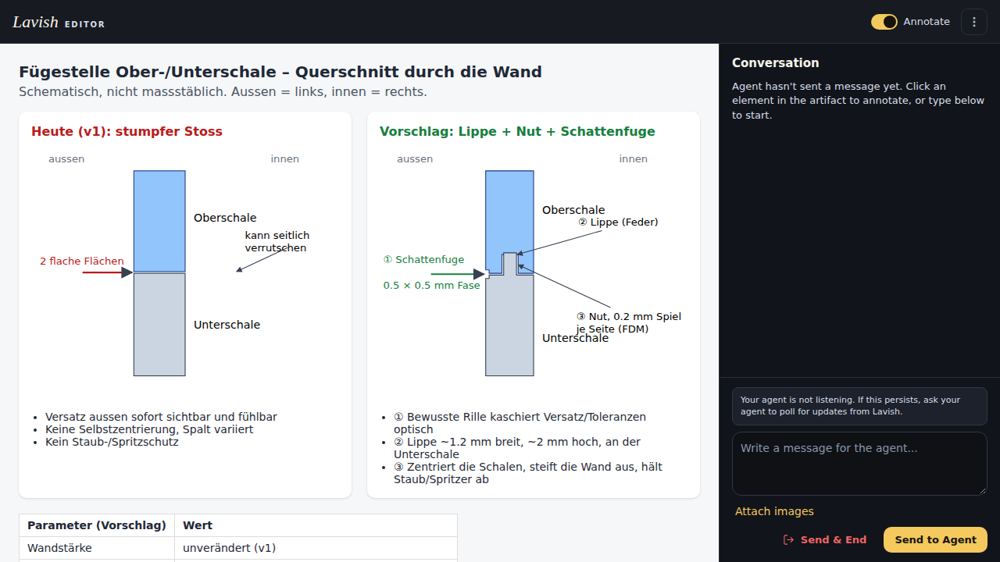

# ADR-0001: Fügestelle Ober-/Unterschale mit Lippe, Nut und Schattenfuge

- **Status:** Angenommen
- **Datum:** 2026-11-08
- **Disziplin:** mechanics
- **Entscheider:** User (Freigabe via Lavish: „Passt doch so.“)
- **Betrifft:** Gehäuse ab r3 (`scripts/mechanics/params.py`, `build_enclosure.py`), Oberschale, Unterschale

## Kontext
In v1 stossen Ober- und Unterschale stumpf mit zwei flachen Flächen aufeinander. Versatz ist aussen sicht- und fühlbar, die Schalen zentrieren sich nicht, es gibt keinen Staub-/Spritzschutz.

## Optionen

Interaktive Quelle: [media/ADR-0001-fuegestelle.html](media/ADR-0001-fuegestelle.html) (schematisch, nicht massstäblich)

1. Stumpfer Stoss (v1) – verworfen.
2. Lippe + Nut + Schattenfuge – **gewählt**.

## Entscheid
| Parameter | Wert | Label |
|---|---|---|
| Lippe (an Unterschale) B × H | 1.2 × 2.0 mm | ANNAHME (Erfahrungswert FDM, Wand v1) |
| Nut (Oberschale), Spiel je Seite | 0.2 mm | ANNAHME, mit Toleranzkörper zu verifizieren |
| Schattenfuge aussen | 0.5 × 0.5 mm, 45°-Fase je Schale | ANNAHME (Gestaltung) |
| Druck | Lippe nach oben, ohne Support | Vorgabe |
| Wandstärke | unverändert | – |

## Konsequenzen
- Mechanik setzt um und verifiziert Kollision, FEM und Slice auf dem neuen Stand (Handoff mechanical-engineer r3).
- Passprobe am realen Druck: NOT RUN.
- Anleitungen/Renderings zeigen die Fuge (docs-media).

## Nachtrag 2026-11-08: Nut-Spiel für SLS
Nach mechanics/ADR-0002 wird in SLS PA12 gefertigt, Toleranz ±0.2 mm (QUELLE JLC3DP). Das Spiel je Seite wird deshalb von 0.2 auf **0.25 mm** erhöht (`params.py`). Für den Eigendruck in FDM bleibt 0.2 mm eine Option.
