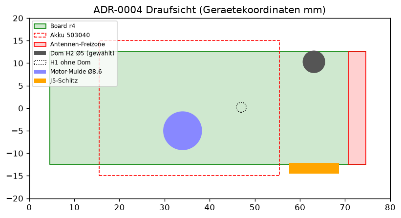

# ADR-0004: Board-Befestigung r4 (M2 selbstschneidend nur H2), J5-Schlitz, Motor-Mulde

- **Status:** Angenommen (Manager 2026-11-08 17:10; Windows-Gegenprobe: Dom H1 kollidiert mit Akku 64.7 mm³)
- **Datum:** 2026-11-08
- **Disziplin:** mechanics
- **Entscheider:** User (Freigabe via Lavish) / Manager
- **Betrifft:** PCB r4 (MASSBLATT_r4.md, INTERFACES.json), params.py, build_enclosure.py, F-10

## Kontext
PCB r4 bringt M2-Löcher H1 (42.4;12.7) und H2 (58.5;22.8), Erweiterungsstecker J5 (JST-SH, 58.5;3.35, Kante y=0) und den Vibrationsmotor LCM0827A3038F Ø8×2.7 (QUELLE INTERFACES.json). Die Bedienplatine 41×27 mm bleibt extern. H1 liegt im Gerät bei (47.0;0.2) und damit über dem Akku 503040 (x 15.5..55.5, z −7.5..−2.5; BERECHNUNG), dort ist kein Dom möglich. Das Gehäuse wird in SLS PA12 gefertigt (ADR-0002).

## Optionen

Interaktive Quelle: [media/ADR-0004-board-befestigung-r4.html](media/ADR-0004-board-befestigung-r4.html)

| Option | Dom-Ø | Bewertung |
|---|---|---|
| A Heat-Insert M2 (Ø3.2 Bohrung) in H1+H2 | ≥ 6.4 mm (ANNAHME Herstellerregel 2×Insert) | H1 kollidiert mit Akku; in PA12-SLS ist Einschmelzen unnötig |
| B Selbstschneidend M2 in H1+H2 | 5.0 mm | H1 kollidiert mit Akku |
| **C Selbstschneidend M2 nur H2 + Randklemmung** | 5.0 mm | gewählt |

## Entscheid
Option C. Dom Ø5.0 mm unter H2 (Gerät 63.1;10.3) von der Unterschale bis Board-Unterseite z = −1.0, Kernloch Ø1.7 × 6 mm (ANNAHME, Gewindeformer M2 in PA12), Schraube M2×6 von oben, Kopf Ø4×1.6. H1 ohne Dom; das Board bleibt zusätzlich über die Klemmrippen der Oberschale gehalten, die für J5 auf x = 26.5/53.0 (−y) verschoben wurden. Abstand Dom zur Antennen-Freizone x ≥ 70.8: 5.2 mm (BERECHNUNG). J5: Wandschlitz 9.5 × 2.8 mm mit 0.6-mm-Aussenfase, innen eine Steckertasche 11.0 × 3.8 mm; der Stecker steckt innen, das Kabel geht nach aussen. Motor: Mulde Ø8.6 × 3.2 mm bei x = 34, y = −5 in der Unterschale, Litzenkanal 3.2 × 2.0 mm zum Board.

## Konsequenzen
- Die Gewindeformer-Verbindung in PA12 ist ungeprüft: NOT RUN (Ausreisstest am Muster).
- pcb-engineer: J5 ist im Board-STEP r4 nicht als Körper erkennbar, die Pin-1-Lage ist zu bestätigen. Ob H1 entfallen oder als Durchgangsloch ohne Schraube bleiben soll, ist offen.
- Eine Schraube H1 ist nur mit Akku-Umplatzierung möglich (Systems).
