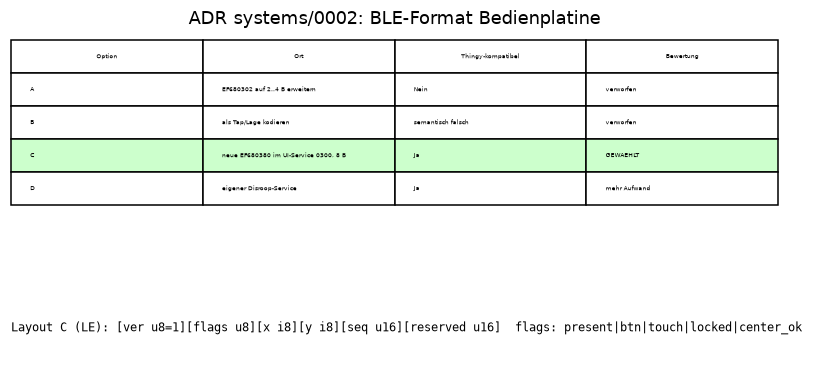

# ADR-0002: BLE-Format Bedienplatine (Stick, Stick-Taste, Touch)

- **Status:** Angenommen (Projektleitung im Auftrag des Users, 2026-11-08)
- **Datum:** 2026-11-08
- **Disziplin:** systems
- **Entscheider:** Manager (Vorschlag systems-engineer, Freigabe User offen)
- **Betrifft:** F-12 Teil 3, Q-04, `docs/protocol.md`, `management/INTERFACES.json` (r4), Firmware `app/src/ble_thingy.c`, `app/src/ext.c`; Grundlage electronics/ADR-0002, firmware/ADR-0004

## Kontext
Die Bedienplatine (J5, r4) liefert Daumenstick X/Y, Stick-Taste und Touch. Die Firmware tastet den Stick nur bei Verbindung ab (50 ms aktiv / 500 ms Ruhe, Totzone 8 %), Touch ist 30 ms entprellt mit Spam-Sperre (firmware/ADR-0004), veröffentlicht wird bisher nur ins Log. Randbedingung: Das Thingy:52-kompatible Profil (`docs/protocol.md` §1) darf nicht brechen; Bridge und App erwarten `EF680302` mit genau 1 B. Im Spielmodus sind 200 Notif./s stabil, 400/s brechen die Windows-Verbindung ab (QUELLE `docs/protocol.md`, Motion-Kanal).

## Optionen

Interaktive Quelle: [media/ADR-0002-ble-bedienplatine.html](media/ADR-0002-ble-bedienplatine.html)

1. **A** – `EF680302` auf 2–4 B erweitern: bricht Clients, die 1 B erwarten. Verworfen.
2. **B** – Stick/Touch als Tap-/Lage-Ereignisse kodieren: formal kompatibel, semantisch falsch, Werte gehen verloren. Verworfen.
3. **C** – neue Characteristic `EF680380` im bestehenden UI-Service `EF680300`, 8 B mit Versionsbyte. Gleiches Muster wie `EF680480` (erweiterter Kanal im Motion-Service). **Gewählt.**
4. **D** – eigener Disroop-Service mit neuer Basis-UUID: kompatibel, aber zusätzliche Discovery und Code in Bridge/App ohne Nutzen.

## Entscheid
`EF680380-9B35-4933-9B10-52FFA9740042`, Service `EF680300`, read + notify, 8 B Little Endian:

| Byte | Typ | Inhalt |
|---|---|---|
| 0 | u8 | `version` = 1 |
| 1 | u8 | flags: bit0 `present`, bit1 Stick-Taste, bit2 Touch, bit3 Touch gesperrt, bit4 Mitte kalibriert; Rest 0 |
| 2 | i8 | X −100..100 % (+ rechts) |
| 3 | i8 | Y −100..100 % (+ vorne, weg vom Griff) |
| 4–5 | u16 | `seq`, +1 je Notify, Überlauf |
| 6–7 | u16 | reserviert = 0 |

- **Rate:** Notify nur bei Änderung und nur mit abonnierter CCC; Deckel 20/s (= Stick-Abtastung 50 ms, BERECHNUNG `scripts/systems/ble_ui_budget.py`). Wenn `motion_freq_hz` > 50 (Spielmodus): Deckel 10/s. Touch- und Tastenflanken gehen dem Deckel vor (Ereignis nicht verlieren: zurückgehaltener Zustand wird spätestens nach 100 ms gesendet).
- **Ohne Bedienplatine:** `present` = 0, x = y = 0, Bits 0; genau ein Notify nach dem Abo, sonst keine. Read liefert jederzeit den aktuellen Zustand. Die Characteristic existiert immer (feste GATT-Tabelle, kein Service-Changed nötig).
- **`EF680302` bleibt** 1 B und meldet nur SW1 der Hauptplatine. Die Stick-Taste wird nicht dorthin gespiegelt (sonst startet sie in der Bridge das Lied).
- **Vorwärtskompatibilität:** Clients akzeptieren Länge ≥ 8, ignorieren Bytes ab 8; bei `version` ≠ 1 nur Byte 0–1 auswerten.
- 8 B + 3 B ATT-Header ≤ 23 B MTU (BERECHNUNG). Stick-Abtastung nur bei Verbindung: bestätigt.

## Konsequenzen
- Firmware: Kodierer + GATT-Eintrag + Ratenbegrenzer (Auftrag im Handoff `management/handoffs/systems-engineer/2026-11-08-ble-ui.md`).
- Bridge/App: optional abonnieren; Thingy-Werksgeräte haben die UUID nicht – fehlende Characteristic ist kein Fehler. Bridge-Change separat (Snapshot-Feld `ui_ext`).
- Risiko: Spielmodus 200 + 10 = 210 Notif./s, 5 % über der gemessenen stabilen Grenze (BERECHNUNG). Verifikation am Gerät unter Windows: NOT RUN.
- Präsenz wird nur beim Start erkannt (firmware/ADR-0004); Hot-Plug bleibt ausserhalb V1.
