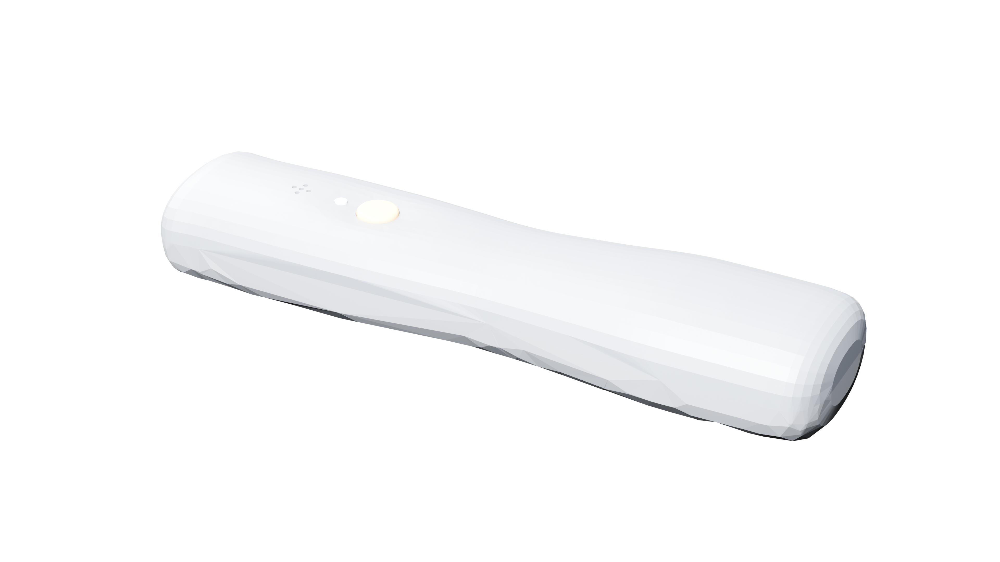
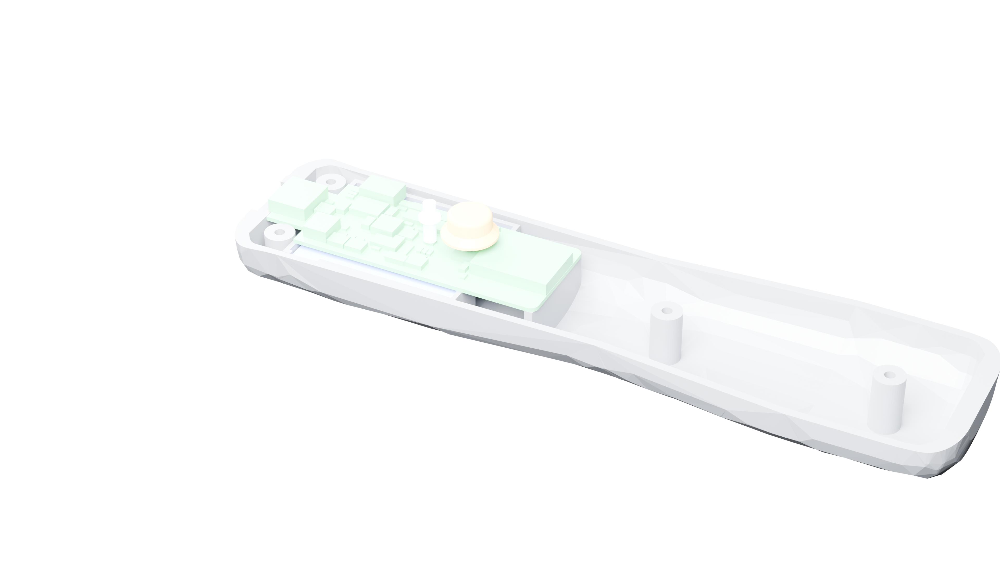
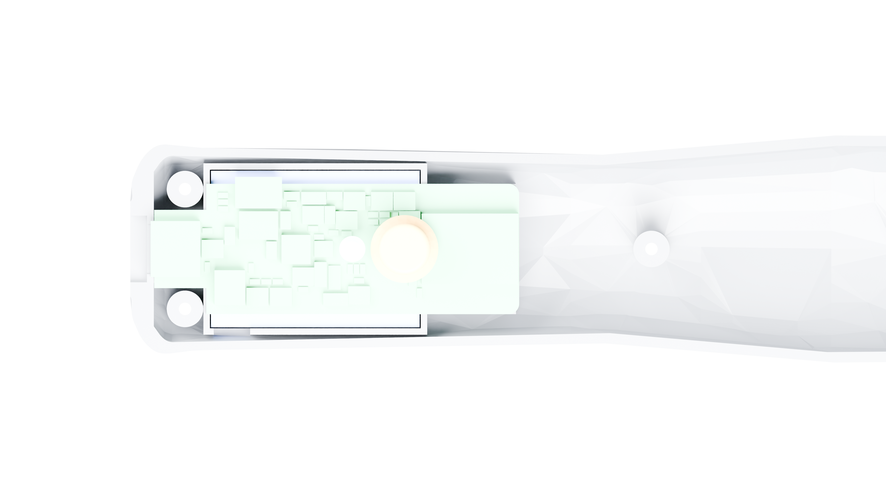
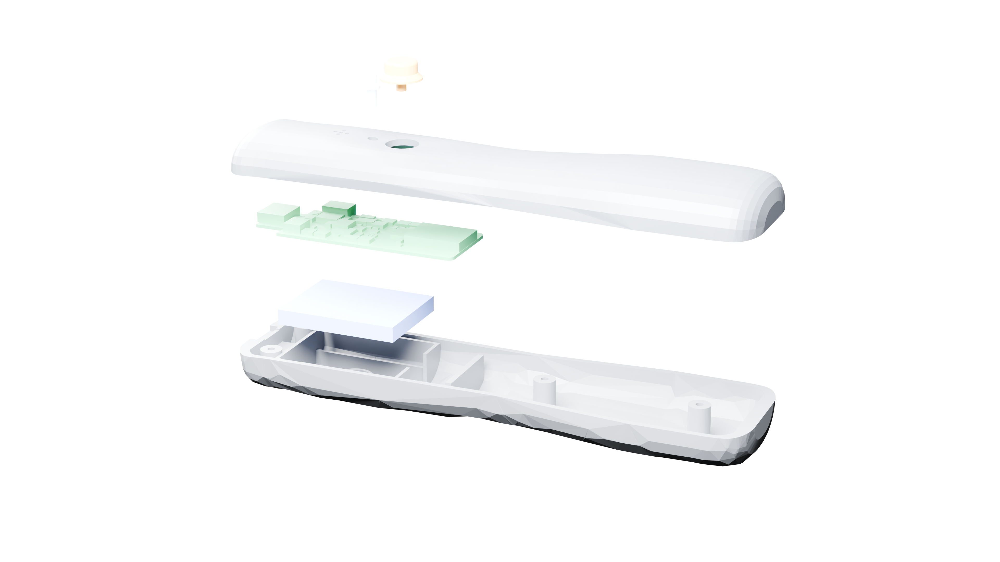

# Motion One – Montageanleitung

> **DRAFT – V1-Integration pending (r3). NOT RUN.** Dieses Dokument ist ein quellengebundener Arbeitsentwurf, keine freigegebene Arbeitsanweisung. Board- und Mechanik-Integration r3 läuft parallel. Wegen der unten aufgeführten Geometriewidersprüche nicht drucken, montieren, Akku anschliessen oder flashen, bevor die zuständigen Disziplinen eine abgestimmte Revision und deren Handoff geliefert haben.

## Status und Kennzeichnung

Alle quantitativen Werte sind mit ihrer Evidenzklasse gekennzeichnet: **QUELLE**, **BERECHNUNG**, **SIMULATION**, **MESSUNG** oder **ANNAHME**. Revisions- und Teilenummern sind Identifikatoren, keine Messwerte. Werte aus älteren oder noch nicht integrierten Handoffs sind nur als getrennte Kandidaten aufgeführt; sie sind keine Montagefreigabe. Echte Hardwareprüfungen, reale Prüfwerte, Anzugsmomente und Sicherheitsbelege sind **offen / NOT RUN**.

## Eingangsstand

- `management/INTERFACES.json` r2: PCB-seitiger Schnittstellenstand [QUELLE].
- `electronics/PINOUT_V1.json` r1: Pinbelegung [QUELLE].
- PCB-Handoff `management/handoffs/pcb-engineer/2026-11-07-v1.md`: PCB-Layout, DRC/ERC und Bauhöhen; Musterprüfungen **NOT RUN** [QUELLE].
- Mechanik-Handoff `management/handoffs/mechanical-engineer/2026-11-07-v1.md`: Gehäuse- und Druckkandidat; gedruckte Passprobe und reale Montage **NOT RUN** [QUELLE].
- Firmware-Handoff `management/handoffs/firmware-engineer/2026-11-07-v1.md` und `firmware/PROGRAMMING.md`: Host-/Build-Ergebnisse vorhanden; Board-Inbetriebnahme **NOT RUN** [QUELLE].
- `sourcing/BOM_V1.md`: elektronische Teileliste und Lieferantenabfrage; kein Beleg für Bestellung oder Wareneingang [QUELLE].

## Offene Integrationswidersprüche

Die folgenden Angaben werden absichtlich nicht zusammengeführt. Erst eine bestätigte r3-Geometrie kann sie auflösen.

| Thema | PCB-/Schnittstellenstand | Mechanik-Handoff | Status |
|---|---|---|---|
| Akku-Steckverbinder J2 | JST-PH bei (15.5; 5.2) mm, Höhe 4.25 mm [QUELLE: `INTERFACES.json` r2] | Gehäusekandidat rechnet mit maximal 3.5 mm Bauhöhe; schlägt alternativ eine Verlegung oder direkte Akkuverdrahtung vor [QUELLE: Mechanik-Handoff, auf Basis r1] | Widerspruch; Position, Variante und Höhe offen. Keine Alternative als beschlossen behandeln. |
| Haupttaster SW2 | (42.3; 12.5) mm [QUELLE: `INTERFACES.json` r2] | Kappe und Daumenmulde auf x=48.0 mm ausgelegt; Mechanik verlangt Rückverschiebung oder Anpassung [QUELLE: Mechanik-Handoff, auf Basis r1] | Widerspruch; Lage und Passung offen. |
| RGB-LED D4 | x=37 mm [QUELLE: `INTERFACES.json` r2] | Lichtleiterkandidat bei x=38 mm; Mechanik bittet um Festlegung auf eine Lage [QUELLE: Mechanik-Handoff, auf Basis r1] | Widerspruch; Lichtleiterposition offen. |
| Befestigung Board | Bohrungen H1 (3.5; 21.5) mm und H2 (48.6; 12.5) mm, Ø2.2 mm, M2 [QUELLE: `INTERFACES.json` r2] | Mechanik meldet H2-Kollision mit Kappe/Stössel und plant Klemmung statt Boardverschraubung [QUELLE: Mechanik-Handoff, auf Basis r1] | Montageprinzip offen; keine Bohrung ignorieren oder übernehmen, bevor r3 abgestimmt ist. |
| Ein-/Ausschalter SW1 | MSK12C02 bei (11; 23.2) mm [QUELLE: `INTERFACES.json` r2] | Mechanik meldet Konflikt mit Schraubdom und fordert eine Verschiebung oder Entscheid zum Entfall [QUELLE: Mechanik-Handoff, auf Basis r1] | Lage, Gehäuseöffnung und Funktion offen. |
| Board-Geometrie | 70 × 25 × 1.0 mm, längliche Kontur [QUELLE: `INTERFACES.json` r2] | Gehäuse v1 wurde anhand eines älteren Schnittstellenstands erstellt; Board-STEP r2 war laut Handoff noch nicht integriert [QUELLE: PCB- und Mechanik-Handoffs] | Kein Pass- oder Kollisionsnachweis für die kombinierte r2/r1-Baugruppe. |
| Firmware-Pins | `PINOUT_V1.json` r1 enthält konkrete Signale [QUELLE] | Firmware-Handoff meldet fehlendes Pinout und beschreibt Platzhalter; `PROGRAMMING.md` führt weiterhin Bootloader-Pins als Platzhalter [QUELLE] | Dokumente widersprechen sich; Pinabgleich und Bootloader-Zuordnung offen. |

Weitere Mechanikpunkte aus dem r1-Handoff: Antennenfreiraum, randfreier Board-Streifen, USB-C-Ausschnitt, Schraubdom-Ausklinkungen und Kabelweg müssen an der integrierten Baugruppe erneut geprüft werden. Keine dieser Prüfungen ersetzt die ausstehende r3-Abstimmung.

## Wareneingang – Prüfliste, nicht ausgeführt

1. Lieferschein und tatsächliche Lieferung mit der freigegebenen, revisionsgebundenen BOM abgleichen. `BOM_V1.md` dokumentiert eine Lieferantenabfrage, nicht vorhandene oder bestellte Ware [QUELLE].
2. Platine, bestückte Komponenten, Gehäuseteile, Akku, Leitungen, Steckverbinder, Schrauben und Einpressmuttern als getrennte Positionen erfassen. Die elektronische BOM enthält keinen vollständigen Nachweis für Gehäuse, Akku und Montage-Hardware; diese Stückliste ist zu ergänzen.
3. Bauteilkennzeichnung und Sichtzustand dokumentieren. Bauteilrotation, Lötqualität, Akku-Polung und mechanische Passung am echten Muster sind **NOT RUN**.
4. Bei beschädigtem, aufgeblähtem, falsch bezeichnetem oder nicht eindeutig identifizierbarem Akku: nicht anschliessen oder laden; Zustand und Herkunft klären. Die vorhandenen Dateien belegen keine Freigabe zur sicheren Nutzung.

## Gehäuse drucken und Slicer

**Noch nicht druckfreigeben:** Die Mechanik beschreibt einen Slicer-Kandidaten, aber sie bestätigt nicht die Integration mit der aktuellen Board-Revision. Druck auf dem realen Gerät und Passprobe sind **NOT RUN**.

Nur als getrennte Referenz aus dem Mechanik-Handoff – nicht als freigegebenes Profil:

| Angabe des Mechanik-Handoffs | Evidenz und Einschränkung |
|---|---|
| Bambu Studio CLI 02.09, P2S, Düse 0.4 mm, Schichthöhe 0.20 mm, Generic PETG [QUELLE] | Handoff nennt dies als Slicer-Konfiguration; echte Druckausführung ist **NOT RUN**. |
| Oberschale und Kleinteile auf einer Platte, Unterschale auf einer weiteren; Baumstützen innen [SIMULATION] | Slice-Ergebnis aus dem Handoff, kein bestätigter Druck oder Passnachweis. |
| 3 Wandlinien, 20 % Infill, Stützschwelle 40° [QUELLE] | Mechanik-Kandidatenparameter; Aktualität nach r3 offen. |
| Gehäuse-Slice zusammen 3 h 56 min und 71.6 g [SIMULATION] | Slicer-Ausgabe im Mechanik-Handoff; kein reales Druckergebnis und keine Sollgarantie. |

Vor einem Druck sind die freigegebenen CAD-/STL-Dateien, ihre Revision, Orientierung, Material, Profil und die aktualisierte Slicer-Ausgabe zu prüfen. Nach r3 ist zuerst eine Passprobe erforderlich; bis dahin keine Gehäusebearbeitung oder Einpressmontage.

## Einpressmuttern – Werte nicht freigegeben

Der Mechanik-Handoff beschreibt als v1-Kandidat vier Ruthex-M2-Einpressmuttern, Löcher Ø3.2 mm und eine Lötspitze bei 220 °C [QUELLE]. Das sind keine freigegebenen r3-Arbeitswerte; echte Einsetzprobe ist **NOT RUN**. Bauteilzahl und Lage können sich mit der noch offenen Gehäuse-/Board-Integration ändern. Einsetztemperatur, Werkzeug, Einsetztiefe, Haltekraft und Prüfverfahren sind vor Ausführung durch Mechanik zu bestätigen. Anzugsmoment für Gehäuseschrauben ist **offen**.

## Montagefolge – geplante Schritte, alle NOT RUN

1. Erst nach Freigabe der integrierten r3-Baugruppe: gedruckte Teile und Passprobe prüfen; Stützen nur gemäss bestätigtem Fertigungsdatensatz entfernen.
2. Einpressmuttern nur gemäss bestätigtem Verfahren einsetzen und dokumentieren.
3. Board, USB-C, Taster, Lichtleiter und Schiebeschalter erst nach Klärung der Tabelle „Offene Integrationswidersprüche“ einsetzen. Keine Klemmung, Bohrung oder Aussparung aus verschiedenen Revisionen kombinieren.
4. Akku erst nach Bestätigung von Typ, Polung, Schutzschaltung, mechanischer Fixierung, Freiraum und Ladeverfahren anschliessen. Die Schnittstellendatei nennt einen 1S-LiPo mit Schutzschaltung, 3.7 V und 500 mAh; Kapazität und Akkuklasse sind dort als **ANNAHME** markiert [ANNAHME: `INTERFACES.json` r2]. Dies ist keine Akku- oder Ladefreigabe.
5. Kabel, Akku und Platine so führen und befestigen, wie die freigegebene r3-Baugruppe es festlegt. Keine Schraube darf auf den Akku wirken; die tatsächliche Konstruktion ist zu verifizieren.
6. Gehäusehälften erst nach bestandener, dokumentierter Funktions- und Sicherheitsprüfung schliessen. Schraubentyp, Reihenfolge und Anzugsmoment bleiben **offen**.

## Firmware und Debugger – keine Programmierung erfolgt

`PROGRAMMING.md` beschreibt einen Kandidatenweg: einmalig Bootloader via SWD, anschliessend App als UF2 über USB; alternativ App via SWD [QUELLE]. Das Dokument sagt ausdrücklich, dass Hardwareablauf **NOT RUN** ist. Vor Nutzung müssen Pinout r1, Firmware-Pinplatzhalter, Bootloader-Boarddefinition und SWD-Padbelegung gegeneinander abgeglichen sein.

Als Debug-Verbindung nennt `PINOUT_V1.json` Tag-Connect TC2030-Pads mit VDD, SWDIO, RESET, SWCLK, GND und NC [QUELLE]. Ein konkreter Anschlussplan mit bestätigter Versorgung, Orientierung und Probe ist offen. Firmwaredateien bauen zu können belegt weder korrektes Pinmapping noch ein funktionierendes Gerät. In diesem Auftrag wurde nichts bestellt, angeschlossen oder geflasht.

## Funktionsprüfung – Prüfplan, reale Werte offen

| Geplante Prüfung | Status / noch erforderlicher Nachweis |
|---|---|
| Sichtprüfung, Kurzschluss-/Bestückungsprüfung und Versorgung | **NOT RUN**; Grenzwerte und Prüfmittel offen. |
| USB-C-Erkennung, Laden und USB-DFU | **NOT RUN**; Strom-, Spannungs-, Temperatur- und Zeitwerte sowie Ladeverhalten am Muster offen. |
| Ein/Aus und Ruhestrom | **NOT RUN**; reale Messwerte fehlen. |
| SWD-Erkennung, Bootloader und UF2-Start | **NOT RUN**; Pin-/Bootloader-Abgleich offen. |
| BLE-Werbung und Verbindung mit Bridge/App | **NOT RUN**; reale Verbindung und App-Ablauf fehlen. |
| Taster, RGB-LED, Lade-LED, Summer und Motor | **NOT RUN**; Funktionen und LED-Zuordnung am Gerät nicht verifiziert. |
| IMU-Daten, Kalibrierung, Batterieanzeige und Bewegungsdaten | **NOT RUN**; reale Referenz- und Toleranzwerte offen. |
| Gehäusepassung, Schliessen und Zugänglichkeit von USB/Schalter | **NOT RUN**; integrierte r3-Geometrie erforderlich. |

## Sicherheits- und Qualitätsblocker

- Keine dokumentierten Sicherheitsbelege für Akku, Ladegerät/Ladeschaltung, Temperaturverhalten, mechanischen Akkuschutz oder Nutzung während des Ladens.
- Keine realen Messwerte für Versorgung, Ladung, Laufzeit, Temperatur, Reichweite, Ruhestrom oder Sensorfunktion.
- Keine bestätigten Anzugsmomente, Einpressparameter oder Endmontage-Prüfgrenzen.
- Keine bestätigte r3-Integration von PCB, Gehäuse, Akku und Kabeln.

## Abbildungen (Stand r3, DRAFT)

Die Renderings entstehen aus den STL-Dateien in `mechanics/assembly_stl/` (**Gehäuse r3**, Board `pcb_r3`). Das r4-Gehäuse ist noch nicht gebaut; die Bilder sind **nicht** der r4-Stand und keine Freigabe. Render: Blender/Cycles, 3840 x 2160 px, RGBA [QUELLE: `scripts/media/render_product.py`].

Beschriftete Explosionsansicht, Anzugsmomente und Montageprüfungen: **offen / NOT RUN**.

Bis diese offenen Punkte geschlossen und die Prüfungen am Muster protokolliert sind, ist diese Anleitung keine Freigabe zur Montage oder zum Betrieb.
