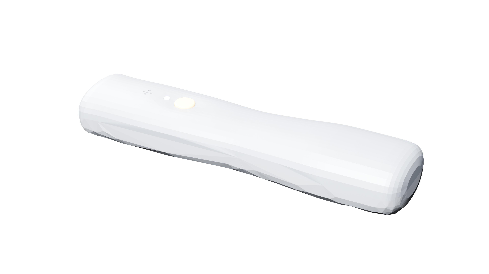
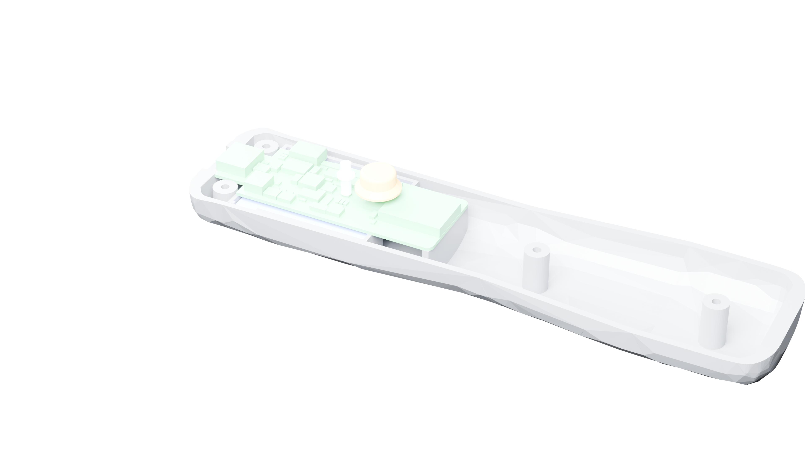

# Motion One – Bedienungsanleitung

> **DRAFT – V1-Integration pending (r3). NOT RUN.** Arbeitsentwurf, keine freigegebene Anleitung für ein ausgeliefertes oder validiertes Gerät. Sämtliche hardwareabhängigen Bedienungs- und Sicherheitsschritte sind **NOT RUN**. Board-/Mechanik-Integration r3 und reale Prüfungen stehen aus.

## Geltungsbereich und Kennzeichnung

Alle quantitativen Angaben sind mit **QUELLE**, **BERECHNUNG**, **SIMULATION**, **MESSUNG** oder **ANNAHME** gekennzeichnet. Revisions-, UUID- und Produktkennungen sind Identifikatoren, keine Messwerte. „NOT RUN“ bedeutet, dass es keinen Nachweis am realen Gerät gibt. Es gibt keine belegte Freigabe für Laden, Tragen, Spielen oder sonstigen Betrieb.

## USB-C, Laden und Daten

Die Schnittstellendatei führt USB-C für 5 V Laden und USB-DFU auf [QUELLE: `management/INTERFACES.json` r2]. Der dortige Wert 5 V ist eine Schnittstellenangabe, keine Bestätigung eines geprüften Ladegeräts oder sicheren Ladeverhaltens. `PROGRAMMING.md` beschreibt USB-UF2 nach einmaliger Bootloader-Programmierung [QUELLE]; auch dieser Hardwareablauf ist **NOT RUN**.

**NOT RUN – nicht als Ladeanweisung verwenden:** Ladegerät/Kabel-Kompatibilität, Ladezustand, Ladezeit, Lade-Ende, Temperaturgrenzen und gleichzeitiger Betrieb sind am Muster nicht geprüft. Bis Ladeverfahren und Sicherheitsnachweise freigegeben sind, den Akku nicht über USB laden. D5 ist als rote CHRG-LED bezeichnet [QUELLE: `INTERFACES.json` r2], aber Bedeutung, Blinkmuster und Anzeige am Gerät wurden nicht geprüft.

## Ein und Aus

Die Schnittstellendatei benennt einen MSK12C02-Schiebeschalter als Ein-/Ausschalter [QUELLE: `INTERFACES.json` r2]. Lage und mechanische Bedienbarkeit sind wegen des dokumentierten Konflikts zwischen PCB- und Mechanikstand offen. BOM und Pinout beschreiben den Schalter-/Versorgungspfad nicht einheitlich genug, um die reale Schaltfunktion hier zu bestätigen.

**NOT RUN:** keine Schaltanweisung am Gerät, keine bestätigte Start-/Abschaltanzeige und kein Test der Ausschaltstromaufnahme. Erst nach r3-Handoff und Musterprüfung ergänzen.

## BLE-Koppeln mit Bridge und Android-App

Als BLE-Werbenamen nennt die Schnittstellendatei „Thingy“ und als Dienstkennung `EF680100-9B35-4933-9B10-52FFA9740042` [QUELLE: `INTERFACES.json` r2]. Sie gibt Bonding als deaktiviert an [QUELLE]. Das sind Protokollangaben, keine erfolgreiche Kopplung oder Kompatibilitätsbestätigung.

**NOT RUN:** Verbindung mit Bridge und Android-App, App-Version, Berechtigungen, Such-/Verbindungsdialog, Wiederverbindung und Fehlerbehandlung wurden nicht am Gerät geprüft. Es gibt daher noch keine belastbare Schritt-für-Schritt-Kopplungsanleitung. Die angegebene Kennung oder der Name allein beweisen keine Unterstützung eines Telefons oder Spiels.

## Kalibrieren

Der Firmware-Handoff beschreibt Bias-Kalibrierung im Ruhezustand oder auf Anforderung über langen Tastendruck; die dort genannte Schwelle von mindestens 0.8 s ist **QUELLE** aus dem Firmware-Handoff, nicht am Gerät gemessen [QUELLE]. Die Funktion, Tasterzuordnung und Benutzer-Rückmeldung sind **NOT RUN**.

Bis zur Hardwareprüfung gibt es keine Bedienfreigabe. Ein späterer Ablauf muss mindestens Start-/Endeanzeige, notwendige Ruheposition, Kalibrierungsdauer und Verhalten bei Bewegung aus einer freigegebenen Firmwareversion belegen.

## Spiele: Tennis und Ski

Tennis und Ski sind im Entwicklungsauftrag als Zielanwendungen genannt [QUELLE: `PROMPT_1_ENTWICKLUNG.md` §11]. Das belegt keine fertige Android-App, Spielkompatibilität oder geprüfte Bewegungserkennung.

**NOT RUN:** Spielauswahl, Bridge-Verbindung, Eingabebelegung, Kalibrierung im Spiel und Spielbetrieb wurden nicht getestet. Bis zu einem App-/Firmware-Handoff mit reproduzierbarem Test keine Anleitung zum Spielen oder Kompatibilitätsaussage verwenden.

## LED-Anzeigen

Das Pinout beschreibt die RGB-Kanäle als aktiv-low [QUELLE: `electronics/PINOUT_V1.json` r1]. Die Schnittstellendatei verweist auf RGB-LED-Modi, enthält hier aber keine verifizierte Benutzer-Legende [QUELLE: `management/INTERFACES.json` r2]. Die rote CHRG-LED D5 wird als Lade-LED bezeichnet [QUELLE]. Das tatsächliche Leuchten, die Bedeutung einzelner Farben/Blinkfolgen und die Unterscheidung zwischen Lade- und Statusanzeige sind **NOT RUN**.

Keine LED-Farbe als Fehler-, Lade- oder Betriebsstatus interpretieren, bevor die Bedeutung mit Firmware und realem Gerät bestätigt und dokumentiert wurde.

## Akku-Sicherheit

`INTERFACES.json` führt einen LiPo-Akku mit Schutzschaltung als Schnittstellenannahme auf: 1S, 3.7 V und 500 mAh; Kapazität und Akkuklasse sind dort als **ANNAHME** gekennzeichnet [ANNAHME]. Das ist weder ein nachgewiesener Akku im Gerät noch ein Sicherheitsnachweis.

Es fehlen insbesondere bestätigter Akkutyp und Datenblatt, Nachweis der Schutzschaltung, freigegebene Ladequelle und Ladegrenzen, Temperaturmessungen, mechanischer Schutz und Validierung des Verhaltens bei Fehlern. **NOT RUN:** Akku laden, Gerät während des Ladens nutzen oder beschädigten Akku handhaben ist nicht freigegeben. Bei sichtbarer Beschädigung, ungewöhnlicher Erwärmung oder Verformung nicht weiterverwenden oder laden; Gerät fern von brennbarem Material ablegen, sofern dies gefahrlos möglich ist, und zuständige Fachstelle/Projektverantwortliche kontaktieren. Diese allgemeine Vorsicht ersetzt keine gerätespezifische Sicherheitsbewertung.

## Fehlerbehebung – Prüfpunkte, nicht am Gerät validiert

Alle Punkte sind **NOT RUN** und dürfen nicht als bestätigte Fehlerdiagnose verstanden werden.

| Beobachtung | Offener Prüfpunkt |
|---|---|
| Gerät erscheint nicht in der Bridge/App | Prüfen, ob ein freigegebener r3-Aufbau und getestete Firmware vorliegen; BLE-Werbung und Berechtigungsablauf sind nicht verifiziert. |
| Gerät startet nicht | Schalterfunktion, Akku, USB-Versorgung und Firmwarestatus sind nicht am Muster geprüft. Gehäuse nicht öffnen und Akku nicht überbrücken. |
| Gerät verbindet, aber liefert keine Bewegung | IMU, Kalibrierung, GATT-Daten und Bridge-/App-Version benötigen einen End-to-End-Test. |
| RGB- oder Lade-LED zeigt ein Muster | Bedeutung unbekannt; Status nicht aus Farbe oder Blinkfolge ableiten. |
| USB-C lädt nicht oder Gerät wird warm | Nutzung/Laden beenden, falls gefahrlos möglich; nicht wiederholt ein-/ausstecken und keine weitere Ladequelle ausprobieren. Lade- und Temperaturverhalten müssen technisch untersucht werden. |

## Noch erforderliche Freigaben

- Abgestimmte Board-/Mechanik-Integration r3 und geklärte Geometriewidersprüche.
- Firmware-Handoff mit endgültigem Pinout, LED-Legende, Taster-/Kalibrierungsablauf sowie getesteten Bridge- und Android-App-Versionen.
- Reproduzierbare End-to-End-Prüfung am realen Muster; alle hardwareabhängigen Angaben bleiben bis dahin **NOT RUN**.
- Akku- und Lade-Sicherheitsbelege, reale Prüfwerte und genehmigte Nutzerhinweise.

## Abbildungen (Stand r3, DRAFT)

Gerenderte Ansichten aus dem Gehäusestand r3 (nicht r4, nicht am realen Gerät geprüft). Lage von Taste, Lichtleiter und Öffnungen kann sich in r4 ändern.

Bedienung am Gerät: **NOT RUN**.

Bis dahin ist diese DRAFT-Anleitung keine Produkt- oder Sicherheitsbehauptung und keine Betriebsfreigabe.
