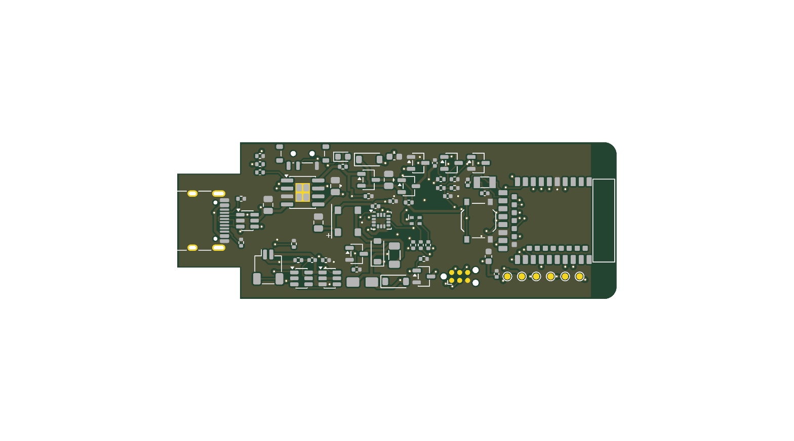

# Elektronik und PCB

Hier liegen Schaltplan, KiCad-Layout, elektrische Simulationen, Baugruppenexport und Firmware-Pinout.

## Stand

Standabgleich 2026-11-13: PCB r4 mit integriertem hierarchischem Schaltplan r4-C.
Die gespeicherten Integrationsbelege vom 2026-11-09 melden Netzlisten MATCH, ERC
ohne Fehler und keine offenen Verbindungen; Hauptplatine mit zwei DRC-Warnungen,
UI ohne DRC-Warnungen [QUELLE:
`exports/pruefbelege_schaltplan_r4/hierarchy-integration.json`]. Die UI-Platine ist
optional und nicht Teil des Geräts/Gehäuses r4. Gesamtstatus **PARTIAL**;
verbindlich ist [PROJECT_STATE](../management/PROJECT_STATE.md).

Das V1-Board ist als 4-Lagen-KiCad-Projekt (70 × 25 × 1,0 mm) erstellt und vollständig geroutet. Der dokumentierte
Prüflauf meldet ERC: 0 Fehler und DRC: 0 Fehler/0 unverbundene Netze; zwei USB-C-Silkscreen-Warnungen sind begründet.
SPICE-Fälle für Power-Path, Einschaltstrom, Summer/Motor und Akku-Messteiler wurden simuliert.



*KiCad-Render des digitalen PCB-Entwurfs, keine gefertigte Platine. Die endgültige PCB-/Gehäuse-Abstimmung läuft noch.*

Diese Ergebnisse gelten für den prototypischen Entwurf, nicht für ein gefertigtes Board. Der PCB-/Gehäuse-Abgleich und
die finale Revision laufen; die Fertigungsdaten müssen nach Änderungen neu exportiert und geprüft werden.

## Wichtige Dateien

- `kicad/motion-one/`: `.kicad_sch`, `.kicad_pcb`, lokale Bibliotheken und STEP-Export
- `analysis/ANALYSE_V1.md`: Leistungs-, Lade-, Regler-, Toleranz- und Fertigungsanalyse
- `spice/`: ngspice-Netzlisten, Logs und Ergebnisse
- `PINOUT_V1.json`: Sollbelegung der E73-Modulsignale; wird vom Firmware-Board-Overlay übernommen
- `../manufacturing/pcba/`: Gerber, Bohrdaten, JLC-BOM/CPL und Renderings
- `../sourcing/BOM_V1.md`: Bauteile, Teilenummern und Lager-Snapshots

## Schnittstellen / offene Punkte

`../management/INTERFACES.json` ist der gemeinsame Vertrag zu Boardumriss, Bauhöhen und Positionen. Der aktuelle
PCB-Stand braucht noch die fachübergreifende Abstimmung mit der Mechanik, anschliessend neue ERC/DRC- und
Fertigungsexporte. CPL-Rotationen sind in der Bestückervorschau zu bestätigen. Finale PCBA- und Versandpreise sind
nicht belegt; ohne Bestellung/Muster bleiben elektrische Messungen NOT RUN.

## Reproduktion

Werkzeuge ausschliesslich im Hardware-Image ausführen, zum Beispiel:

```sh
./project hw run "kicad-cli version"
./project hw run "ngspice -b devices/motion-one/electronics/spice/powerpath.cir"
```

Der aktuelle Hauptschaltplan-Generator ist `../scripts/electronics/gen_mo_sch_hier.py`.
Ältere Generatoren und Migrationsskripte sind keine austauschbaren Einstiegspunkte:
Sie können ältere Stände erzeugen oder Quellen verändern. Die genauen Generator-,
ERC-, DRC- und Exportbefehle stehen in `../scripts/electronics/` und im datierten PCB-Handoff.
