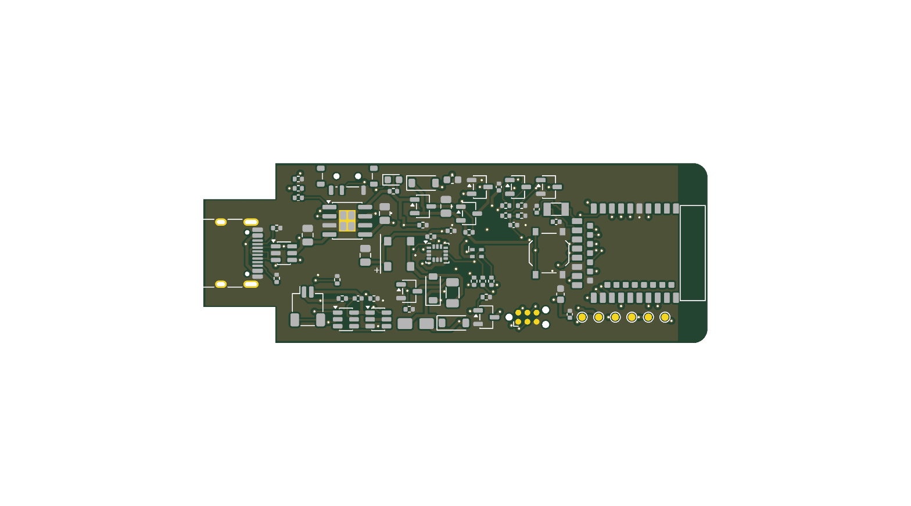
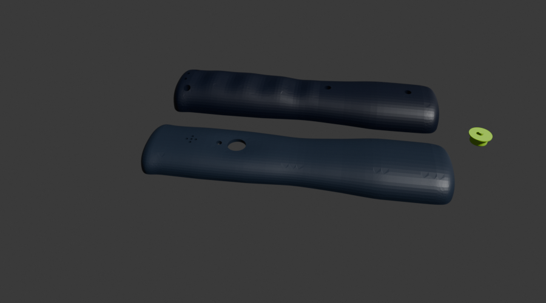

# Fertigungspakete

Dieser Ordner enthält digitale Übergabedateien für Platinenbestückung und 3D-Druck.

## PCB/PCBA

`pcba/` enthält das Gerber-/Bohrdaten-ZIP, JLCPCB-BOM und CPL sowie PCB-Renderings. ERC/DRC wurden am KiCad-Entwurf
ausgeführt. Vor Upload sind die Endrevision, Bauteilrotationen, Teilenummern, Lagerstände und DFM-Rückmeldungen in der
Bestückervorschau zu prüfen. Die Versand-/Gesamtkosten sind noch nicht vollständig belegt. Nichts wurde bestellt oder
bezahlt.

*KiCad-Render; keine gefertigte oder bestückte Leiterplatte.*

## 3D-Druck

`print/` enthält das Bambu-Studio-Projekt für die Gehäuseteile und den Toleranzkörper. Der Slicer-Lauf ist ein
digitaler Test, kein physischer Druck. Zuerst den Toleranzkörper drucken und Passungen messen; anschliessend Druckprofil,
Material und Slicer-Ergebnis für die finale CAD-Revision bestätigen.

*CAD-Render; kein tatsächlich gedrucktes Teil.*

## Status

V1-Fertigung ist **PARTIAL / NOT ORDERED**. PCBA-Paket und Druckdateien werden nach PCB-/Mechanik-Integration neu
geprüft. Keine Datei autorisiert eigenständig eine Bestellung, Bezahlung oder Fertigung.
