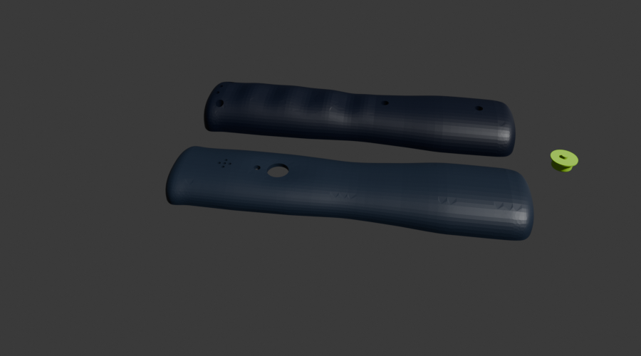

# Mechanik

Parametrisches CAD für ein ergonomisches Einhandgehäuse mit zweiteiliger Schale, Daumentaster, Lichtleiter, USB-C-
Ausschnitt, Akkuhalterung, Summeröffnung und Vibrationsmotorhalter.

## Stand

Das V1-Design ist ein beidhändig nutzbarer, taillierter Griff mit Fingerwellen und Daumenmulde. CAD-Teile, STEP,
STL/3MF, Toleranzkörper und PETG-Slicerprojekt sind erzeugt; Gehäusezeit laut Slicer 3 h 56 min und 71,6 g Material
(SIMULATION, nicht gemessener Druck). Ergonomie und Passungen sind nicht physisch getestet.



*CAD-Render der Gehäuseteile, kein Foto eines gedruckten oder montierten Geräts. Geometrie und Board-Schnittstellen
werden in der laufenden Integration noch geprüft.*

FEM-Vergleich der Varianten liegt vor, aber die Netzkonvergenz ist PARTIAL: die Netze wurden aus STL statt einer
gültigen BREP-Geometrie erzeugt. Auch die Kollisionen müssen gegen die finale PCB-Revision erneut geprüft werden.
Keine Behauptung über Fallfestigkeit oder Produktsicherheit ist dadurch belegt.

## Wichtige Dateien

- `../scripts/mechanics/params.py`: zentrale Parameter (mm) und markierte Annahmen
- `cad/`: Gehäuse-STEP und CAD-Ergebnisse
- `fem/`: Netze, FEM-Modelle und Ergebnisdaten
- `print/`: Druckorientierte STL/3MF und Slicer-Ergebnisse
- `renders/`: Vorschau der Druckteile
- `../manufacturing/print/`: vorbereitete Bambu-Studio-Druckprojekte

## Reproduzieren

```sh
./project hw run "python3 devices/motion-one/scripts/mechanics/build_enclosure.py"
```

Der finale Schnittstellenvertrag steht in `../management/INTERFACES.json`. Nach Boardänderungen CAD-Bau, Kollisions-
prüfung und Slice erneut ausführen. Erst den Toleranzkörper drucken und Spiel messen, bevor das Gehäuse gedruckt wird.

## Gehäuse r4: Stand und nicht gemachte Prüfungen (2026-11-09)
User-Entscheid: Prototypen-Gehäuse wird selbst gedruckt, Rückmeldung nach dem ersten Druck. Folgende Prüfungen sind **NOT RUN** und werden bewusst übersprungen:
- Wandstärke im Modell (Ziel ≥ 1.0 mm): Raycast/Querschnitt unbrauchbar, Voxel-Messung (`scripts/mechanics/wall_edt.py`) nicht gelaufen. Verdacht: Nut/Schattenfuge nur ca. 0.45 mm Restwand in der Oberschale (Messung unsicher).
- Lippe/Nut-Spiel nach `LIP_D0` 1.8 nicht geprüft.
- `pcb_r4.stl`: Dichtheit widersprüchlich (Mechanik 34 von 72 Körpern undicht, PCB-Agent 40/40 dicht). Nur Kollisionskörper, kein Druckteil; `collision_r4.json` Gesamtlabel FAIL deswegen.
- Neubau mit `LP_GAP` 0.0 und `CAP_TRAVEL_GAP` 0.1 fehlt (STL zeigen noch 0.2/0.3 mm Luft). Kurz bauen vor dem Druck.
- FEM, SLS-Toleranzen, Slicer-Lauf für r4, Renders/Explosionsansicht auf r4 nicht erneuert.
- Netz-Kollision (manifold3d, SIMULATION): keine Kollision; Schalen-Kontakt 1.05 mm³ an der Trennebene ist Messartefakt.

Risiken für den ersten Druck (Prototypenphase): (1) Wand an Nut/Fuge dünn, mit 0.4-mm-Düse prüfen, ggf. `LIP_D0` erhöhen; (2) Kappen-/Lichtleiterspiel bewusst knapp lang, nachfeilen; (3) J5-Fase ist abgeschaltet (J5-Öffnung ohne Fase); (4) Drucker-Toleranz FDM ≠ SLS: Toleranzkörper `print/toleranzkoerper.3mf` zuerst drucken; (5) Akku-/USB-C-/Bedienplatinen-Passung nur im Modell geprüft.

### r4-Lücken (2026-11-09)
- Neu: Schieber SW1 (`print/schieber.stl/.3mf`, Griffkappe mit 5 Rillen, Hub ±1.5, Spiel 0.2, Kragen innen) und 3 Platinen-Schnapphaken in der Unterschale. Im Viewer und `explode.json` eingetragen.
- Vollbau glatt mit `LP_GAP` 0.0 und `CAP_TRAVEL_GAP` 0.1 gelaufen. Netz-Kollision (SIMULATION): 0 Kollisionen; Gesamtlabel FAIL nur wegen `pcb_r4.stl`.
- NOT RUN: Hebelmasse gegen Datenblatt, Clip-Federweg, Schieber-Endlagen. Drei Klemmrippen der Oberschale wurden beim Bau verworfen (offen).
- Details und Liste fehlender Elemente: [Handoff](../management/handoffs/mechanical-engineer/2026-11-09-r4-luecken.md).
- Nachtrag: USB-Aussparung 14x8x4.45, Klemmrippen repariert (Innenraum-Subtraktion), Clips im Build, SW1-Hebel 1.4, Servicedurchbruch J4, Schieber-Prägung I/O. Stand Netz-Kollision: 0 (SIMULATION). Details im Handoff.
