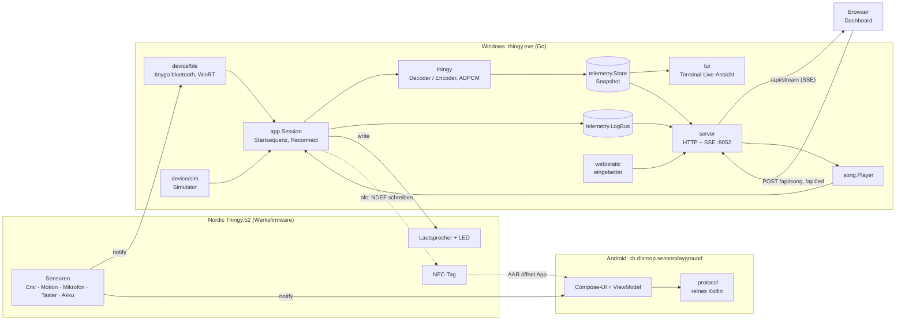
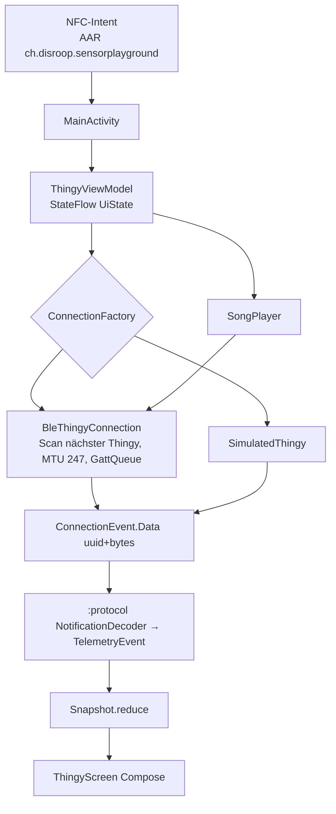

# Architektur

## Überblick

Der Thingy nimmt **nur eine BLE-Verbindung** gleichzeitig an. Es ist also entweder `thingy.exe` oder die Android-App verbunden, nie beide.

## Datenfluss in `thingy.exe`

1. **Verbinden:** `app.Session.Run` holt über den `device.Connector` ein `device.Device`. Geht die Verbindung verloren, verbindet sich die Session nach 3 s neu. Findet sie keinen Thingy, gibt sie den Hinweis „Taste drücken oder schütteln“ aus.
2. **Startsequenz** (`app.Configure`, gemäss [protocol.md](protocol.md#startsequenz-client)):
   - Motion-Config schreiben: 10 Hz, Kompass 100 ms
   - Env-Config lesen, dann mit 1-s-Intervallen zurückschreiben
   - Sound-Config `[1, 1]`: Frequenz-Lautsprecher, ADPCM-Mikrofon
   - alle Notify-Characteristics abonnieren und den Akku einmal lesen
3. **Dekodieren:** `app.Session.Handle` leitet jede Notification an den passenden Decoder in `internal/thingy` weiter, zum Beispiel `DecodeTemperature` oder `DecodeRawMotion`. Für das Mikrofon dekodiert `internal/thingy` IMA-ADPCM, rechnet RMS in dBFS um, glättet mit einer EMA (α = 0.3) und publiziert mit höchstens 10 Hz. Ungültige Pakete loggt die Session pro Characteristic nur beim ersten Mal.
4. **Telemetry-Store:** `telemetry.Store` hält einen `Snapshot`. Das Format folgt [telemetry.schema.json](telemetry.schema.json). Werte, die noch nicht angekommen sind, bleiben `null`. Jede Änderung bekommt einen neuen Zeitstempel und benachrichtigt die Abonnenten zusammengefasst und nicht blockierend.
5. **Ausgabe:**
   - `tui` zeichnet die Terminal-Ansicht neu, höchstens alle 100 ms.
   - `server` liefert `/api/state` und `/api/stream`. SSE sendet `telemetry` gedrosselt auf ≤ 10 Hz pro Client und `log`-Meldungen. Alle 15 s geht ein Keep-alive-Kommentar raus.
   - Das Web-Dashboard liegt per `go:embed` in der exe (`bridge/web/embed.go`).
6. **Aktoren:**
   - `song.Player` spielt `shared/chorus.json` über `Session.Tone` und `Session.LED`/`LEDOff`.
   - Ausgelöst wird das Lied per `POST /api/song` oder per Taster am Thingy (`Session.OnButton` → `Player.Toggle`).
   - `POST /api/led` setzt eine feste Farbe.

### Ports & Adapters

| Port (`internal/device`) | Adapter | Verwendung |
|---|---|---|
| `Connector`, `Scanner`, `Device` | `device/ble` (`ble_windows.go`) | echte Hardware, nur unter Windows (WinRT über `tinygo.org/x/bluetooth`, `CGO_ENABLED=0`) |
| | `device/ble` (`ble_other.go`) | Stub ausserhalb von Windows, Fehler „--sim verwenden“ |
| | `device/sim` | Simulator. Er sendet **dieselben rohen GATT-Bytes** wie die Werksfirmware, damit die Decoder Ende-zu-Ende laufen. `device.source = "sim"` |
| `song.Output` | `app.Session` | Ton und LED. In Tests ersetzt ein Fake den Adapter. |
| `server.SongControl`, `server.LEDControl` | `song.Player`, `app.Session` | HTTP-Steuerung |

Die ganze Logik ist ohne Gerät testbar: Decoder, Store, Session, Player, Server und TUI. Nur `ble_windows.go` braucht echte Hardware.

### Pakete

| Paket | Aufgabe |
|---|---|
| `cmd/thingy` | Flags, Unterbefehle (`tennis`, `scan`, `song`, `nfc`), Verdrahtung |
| `internal/thingy` | UUIDs, Decoder, Encoder (LED, Speaker, Configs, NDEF/AAR), IMA-ADPCM, Pegelmesser |
| `internal/device` (+ `ble`, `sim`) | Port und Adapter zum Thingy |
| `internal/app` | Session (Startsequenz, Reconnect, Notifications → Store), NFC-Programmierung |
| `internal/telemetry` | Snapshot-Typen, Store, LogBus |
| `internal/song` | Lied parsen und abspielen, Farbe pro Tonhöhe |
| `internal/server` | HTTP-API, SSE, WebSocket `/api/motion`, `/api/beep`, MIME-Typen, CORS |
| `internal/motion` | schneller Motion-Kanal: Quaternion/Raw/Taster/Tippen → Frames, 100 Hz solange ein Client zuhört (Spielmodus: nur Quaternion + Raw Motion schnell, Euler/Kompass pausiert) |
| `internal/tui` | Terminal-Live-Ansicht (ANSI, auf Windows mit VT-Modus) |
| `web` | `go:embed` des Dashboards |
| `internal/tennisapp` | `go:embed` von Thingy Tennis (`tennis/` gebaut nach `dist/`), Details [TENNIS.md](TENNIS.md) |

## Web-Dashboard

Das Dashboard besteht aus ES-Modulen **ohne Build-Step** (`bridge/web/static/js`):
- Die Logik steckt in reinen, mit `node --test` getesteten Modulen: Reducer `state.js`, `format.js`, `classify.js`, `chart.js`, `ringbuffer.js`, `backoff.js` und weitere.
- `view.js` und `live-chart.js` sind eine dünne DOM- bzw. Canvas-Schicht.
- `connection.js` baut die `EventSource` bei Abbruch mit exponentiellem Backoff (0.5–10 s) neu auf.
- Kommt 3 s lang kein Wert, zeigt das Dashboard „Daten veraltet“.

Details: [bridge/web/README.md](../bridge/web/README.md).

## Android-App

- **`:protocol`** (reines Kotlin/JVM, JUnit) enthält UUIDs, Decoder, Commands, Startsequenz, IMA-ADPCM, NDEF, Snapshot und Song. Das Lied liest das Modul beim Build aus `shared/chorus.json`.
- **`:app`** (Compose, Material 3):
  - `ThingyConnection` ist der Port. Adapter sind `BleThingyConnection` (direkter GATT-Client mit serialisierter `GattQueue` und Auto-Reconnect) und `SimulatedThingy`.
  - Der Simulator ist umschaltbar und automatisch aktiv, wenn das Gerät kein BLE hat.
- In `onStop` trennt die App die Verbindung. So ist der Thingy wieder frei für `thingy.exe`.
- Ein NFC-Tap (`NDEF_DISCOVERED` mit `vnd.android.nfc://ext/android.com:pkg`) verbindet sofort per BLE.

Details: [android/README.md](../android/README.md).

## Entscheide

### Warum die Werksfirmware?
- Es ist keine SWD-Debug-Probe vorhanden. Die Werksfirmware bietet alle Sensoren, den Lautsprecher (Frequenz-Modus), die LED und sogar den NFC-Inhalt per BLE an. Eigene Firmware bringt für die Demo keinen Mehrwert.
- Der NFC-Inhalt (`EF680109`) wird persistent gespeichert. Mit einem Backup lässt er sich jederzeit zurückschreiben.

### Warum eine Windows-exe?
WSL2 hat keinen Zugriff auf Bluetooth, und PowerShell kann keine WinRT-BLE-Events abonnieren. Deshalb wird Go mit `tinygo.org/x/bluetooth` und `GOOS=windows CGO_ENABLED=0` im Container cross-kompiliert. Gestartet wird die exe über WSL-Interop. Für Smoke-Tests im Container gibt es zusätzlich `thingy-linux`, das nur mit `--sim` funktioniert.

### Warum ein Devcontainer?
- Ein Image (`.devcontainer/Dockerfile`) enthält Go, staticcheck, Node, JDK 21, das Android SDK und Chromium.
- `./project`, VS Code „Reopen in Container“ und die geplante CI nutzen dasselbe Image. Lokal wird nichts installiert, und alle bauen mit denselben Versionen.
- Caches (Go-Module, Gradle) liegen im Docker-Volume `disroop-sensor-playground-cache`.

### Simulator first
Jede Komponente hat eine Simulator-Quelle: Go `device/sim`, Web `dev/sim.js` + `dev/mock-server.js`, Android `SimulatedThingy`. Damit laufen Smoke-Tests ohne Hardware, offline und in der CI.

## Verträge

- [protocol.md](protocol.md): GATT-Characteristics, Formate, Startsequenz, Lied, NFC-AAR, Bridge-HTTP-API
- [telemetry.schema.json](telemetry.schema.json): JSON-Schema des Snapshots, Beispiel in [shared/telemetry.example.json](../shared/telemetry.example.json)
- [shared/chorus.json](../shared/chorus.json): einzige Quelle des Lieds. Bridge, Mock-Server und Android lesen es. Das Dashboard spiegelt nur die Tonhöhen in `static/js/chorus.js`, und `test/chorus.test.js` prüft, dass beide übereinstimmen.
- [ENGINEERING.md](ENGINEERING.md): TDD, Clean Code, Smoke-Tests
