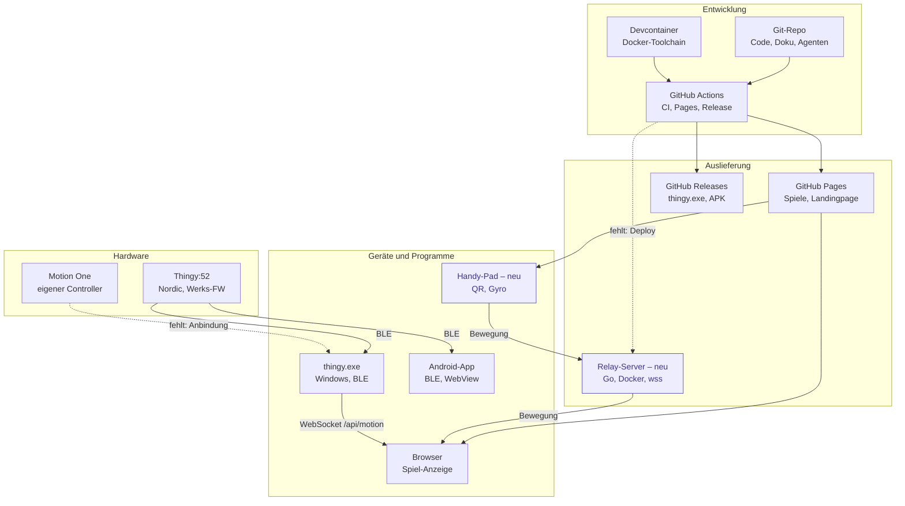

# Systemlandschaft disroop Playground

Status: **Konzept, Umsetzung später** (User, 2026-11-08). Gehört zu [`KONZEPT_PLAYGROUND.md`](KONZEPT_PLAYGROUND.md) und [`KONZEPT_HANDY_CONTROLLER.md`](KONZEPT_HANDY_CONTROLLER.md).

## Übersicht

## Bausteine

| Ebene | Baustein | Rolle | Status |
|---|---|---|---|
| Entwicklung | Git-Repo | Alles an einem Ort: Code, Doku, Agenten-Definitionen, Journal | vorhanden |
| | Devcontainer | Gesamte Toolchain in Docker (Go, Node, JDK, Android SDK, Chromium) | vorhanden |
| | GitHub Actions | `ci.yml`: Test und Build je Bereich, Release mit exe und APK. `pages.yml`: Pages-Deploy | vorhanden |
| Auslieferung | GitHub Pages | Landingpage, Tennis, Ski, Motion-One-Präsentation über HTTPS | vorhanden |
| | GitHub Releases | `thingy.exe` und Debug-APK | vorhanden (CI-Job da) |
| | Relay-Server | Leitet Bewegungsdaten von Handys an den Spielbildschirm weiter, Räume per Code, Ranglisten im Speicher | **neu** |
| Geräte | Browser | Grosser Bildschirm, zeigt das Spiel | vorhanden |
| | Handy-Pad | Webseite per QR-Code, liest Gyro und Beschleunigung | **neu** |
| | thingy.exe | BLE-Bridge unter Windows, Dashboard `:8052`, `/api/motion` | vorhanden |
| | Android-App | Direkt per BLE, Spiele in WebViews, Start per NFC | vorhanden |
| Hardware | Thingy:52 | Sensor-Würfel mit Werksfirmware | vorhanden |
| | Motion One | Eigener Controller (PCB, Firmware, Gehäuse) | in Entwicklung |

## Was fehlt

### Für das Relay (Engpass für den Handy-Controller)

1. **Registry:** Das Docker-Image des Relays liegt in GHCR (GitHub Container Registry). Kein weiteres Konto nötig.
2. **Hosting:** Ein Ort, wo das Relay läuft (Fly.io, Cloud Run oder eigener Server), dazu eine Domain, z. B. `play.disroop.ch`, mit TLS. Ohne `wss://` gibt das Handy keine Sensoren frei.
3. **Relay-Deploy:** Ein Job in GitHub Actions, der bei einem Push auf `main` das Image baut, nach GHCR schiebt und ausrollt. Das Deploy-Token liegt als Secret in GitHub.
4. **Betrieb:** Endpunkt `/healthz`, strukturierte Logs und eine kleine Statusanzeige (verbundene Räume und Pads). Am Messetag will man sehen, dass das Relay lebt.

### Weitere Lücken

- **Motion One anbinden:** Adapter in der Bridge (BLE wie beim Thingy) oder Web Bluetooth direkt im Chrome auf Android.
- **Spiele-Katalog:** `game.json` pro Spiel, die Landingpage liest die Spiele daraus, statt sie fest einzutragen.
- **Signierung:** `thingy.exe` ist unsigniert (Windows SmartScreen warnt), die APK nutzt den Demo-Schlüssel. Für Kundendemos ist das etwas holprig, für die Demo aber akzeptabel.
- **Offline-Kit für Messen:** eigener WLAN-Router, auf dem das Relay lokal läuft, falls das Netz vor Ort schlecht ist.

### Bewusst nicht

- **Keine Datenbank für Ranglisten.** Es ist eine Demo: Die Ranglisten leben im Speicher des Relays und verschwinden beim Neustart (User, 2026-11-08).
- Keine Benutzerkonten, nur Spitznamen pro Runde.

## Reihenfolge, wenn es umgesetzt wird

1. Registry, Hosting und Relay-Deploy zusammen, denn ohne sie gibt es keinen Handy-Controller.
2. Handy-Pad und Relay (siehe Handy-Konzept), dann Skicross.
3. Spiele-Katalog und Umbau der Ordnerstruktur (siehe Playground-Konzept).
4. Motion-One-Anbindung, Offline-Kit und Signierung nach Bedarf.
