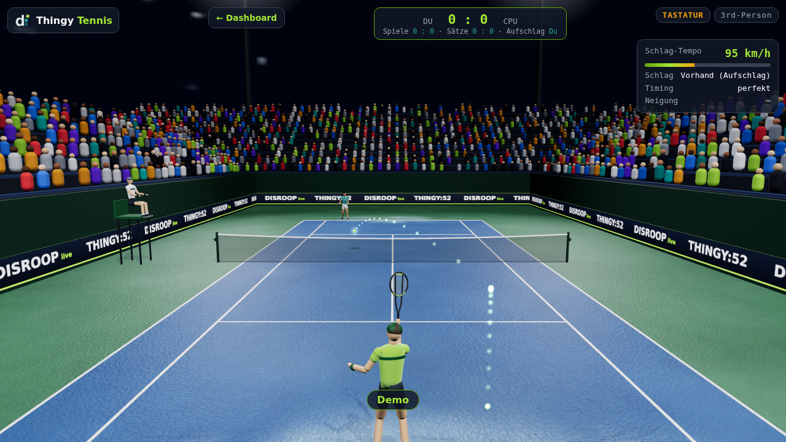

# Thingy Tennis

Tennis im Browser, der **Thingy:52 ist der Schläger**. Ein eigenes Programm im Repo (`tennis/`). Die Bridge liefert es unter
http://127.0.0.1:8052/tennis/ aus, die Bewegungsdaten kommen über den schnellen WebSocket `/api/motion` (100 Hz).
Ohne Thingy spielst du mit der Tastatur, und der Simulator schwingt für Demos.


*Demo-Rally, 3rd-Person-Kamera (`./project tennis screenshot`).*

## Starten

| Was | Befehl |
|---|---|
| Echter Thingy | `./t tennis.play` oder `./project play` oder direkt `build\thingy.exe tennis` unter Windows |
| Simulator (ohne Hardware) | `./t tennis.play --sim` (Port 8060) oder `./project play --sim` oder `thingy.exe tennis --sim` |
| Bridge läuft schon | http://127.0.0.1:8052/tennis/ öffnen (`./t tennis.open`) |
| Nur Tastatur | `/tennis/` öffnen, auch ohne verbundenen Thingy |

`thingy.exe tennis` startet die Bridge wie gewohnt (Terminal-Anzeige, Dashboard) und öffnet zusätzlich das Spiel im
Standardbrowser (`--no-browser` verhindert das). Im Tennis-Modus startet der Taster das Lied nicht.

Nützliche URL-Parameter: `?demo=1` (Autopilot spielt), `?cam=first|tv`, `?diff=leicht|schwer`.

## So spielst du

1. **Kalibrieren:** Den Thingy wie einen Schläger in neutraler Haltung halten (Vorhand-Seite zeigt nach rechts) und den
   **Taster kurz drücken**. Der erste Frame kalibriert automatisch, lang drücken (≥ 0,8 s) kalibriert jederzeit neu.
2. **Start:** im Menü `Start` oder Taster kurz drücken.
3. **Laufen:** Du läufst automatisch zum Ball. **Neigen** (links/rechts kippen) steuert zusätzlich seitlich
   (Totzone 8°, volle Geschwindigkeit ab 30°).
4. **Schlagen:** Schwingen, wenn der Ball ankommt. Den Aufschlag wirft das Spiel nach 1 s selbst hoch (oder Taster),
   schlagen am besten ~0,6 s nach dem Wurf.

| Bewegung | Wirkung |
|---|---|
| Schwung schneller als ~350 °/s | Schlag (mit Hysterese: Ende unter 200 °/s) |
| Schwunggeschwindigkeit | Tempo: 350 °/s ≈ 60 km/h … 1200 °/s ≈ 160 km/h; über 150 km/h geht leicht ins Aus |
| Drehrichtung um die Hochachse | Vorhand oder Rückhand |
| Schlägerfläche geöffnet (Roll ≥ 28° gegenüber Kalibrierung) | Slice (Rückwärtsdrall, flacher und langsamer) |
| Timing: früh / genau / spät | cross / Mitte / longline (Vorhand früh = links); ganz am Rand des Fensters geht's seitlich ins Aus |

### Tastatur und Maus (ohne Thingy)

| Taste | Funktion |
|---|---|
| Leertaste / Klick | Schlag (Vorhand oder Rückhand je nach Ballseite), im Menü: Start |
| ↑ / ↓ gedrückt halten | harter Schlag / Slice |
| ← / → | seitlich laufen |
| C | Kamera: 3rd-Person → 1st-Person → TV |
| K | kalibrieren |
| M | Ton aus/an |
| Esc | Menü |

Zählweise wie im Tennis: 15/30/40, Einstand, Vorteil, Spiel; ein Satz bis 6 (zwei Spiele Vorsprung, Tiebreak bei 6:6).
Schwierigkeit `leicht`/`mittel`/`schwer` ändert Laufgeschwindigkeit, Reaktion, Reichweite und Fehlerquote der CPU.

## Sensor-Mapping

| Thingy | Kanal | im Spiel |
|---|---|---|
| Quaternion `EF680404` | `q` | Schlägerhaltung (Modell folgt `q0⁻¹ ⊗ q`), Roll → Slice, Neigung → Steuern |
| Gyroskop `EF680406` | `gyro` | Schwung erkennen, Tempo, Vor-/Rückhand (Drehung um die Welt-Hochachse) |
| Beschleunigung `EF680406` | `accel` | mitgeschickt, derzeit ungenutzt |
| Taster `EF680302` | `button` | kurz: kalibrieren / Start / Aufschlag, lang: neu kalibrieren |
| Lautsprecher + LED | `POST /api/beep` | Treffer (grün, hoher Ton), Punkt (lime), Fehler (rot, tiefer Ton) |

Thingy-Achsen: Z nach oben, für three.js wird `(w,x,y,z)` zu `(w,x,z,−y)`.

## Architektur

```
Thingy ──BLE 100 Hz──▶ thingy.exe ──WebSocket /api/motion──▶ link.ts ──▶ core/controller.ts (Kalibrierung, Schwung, Taster)
                                  ◀──POST /api/beep──────────           │
                                  ──GET /tennis/ (embed)──▶ Browser     ▼
                                                              core/game.ts (Physik, Regeln, CPU)  ──▶ scene.ts (three.js) + hud.ts + audio.ts
```

- **`tennis/src/core/`**: reiner, deterministischer TypeScript-Spielkern ohne three.js (Unit-Tests in `tennis/test/`):
  `quat` · `motion` (Frame-Parser) · `calibration` · `swing` (Schwungdetektor) · `controller` · `physics`
  (Schwerkraft, Luftwiderstand, Magnus/Drall, Absprung, Netz, Bisektion für Zielschläge) · `scoring` · `cpu` · `game`
  (Zustandsmaschine Aufschlag → Rally → Punkt, Autopilot für Demo/Menü) · `rng`.
- **`tennis/src/`**: Browser-Teil – `scene.ts` (Flutlicht-Platz, Schatten, ACES-Tonemapping, Ballspur, 3 Kameras,
  devicePixelRatio ≤ 2), `hud.ts`, `audio.ts` (WebAudio: Schlag, Aufsprung, Netz, Publikum), `link.ts`
  (WebSocket mit Reconnect, LIVE/SIM-Badge aus `/api/state`), `main.ts`.
- **Kein Bundler:** `tsc` übersetzt nach `tennis/dist/js`, `three` (npm, Version fest) wird nach `dist/vendor/three` kopiert
  und per Importmap geladen – das Spiel läuft offline.
- **Bridge:** `./project tennis build` kopiert `tennis/dist` nach `bridge/internal/tennisapp/dist`, das per `go:embed` in die
  exe kommt. Motion-Hub `bridge/internal/motion`, Endpunkte in [protocol.md](protocol.md).

## Entwickeln und testen

```bash
./project tennis test        # build + typecheck + Unit-Tests + headless-Chromium-Smoke (Software-WebGL)
./project tennis screenshot  # docs/img/tennis.png
./project bridge test        # u. a. /api/motion ≥ 50 Hz und Tennis-Smoke gegen die echte Bridge im Simulator
```

`node tennis/dev/stats.ts` (im Devcontainer) spielt viele Autopilot-Rallys und zeigt
Gewinnschläge/Fehler je Schwierigkeit – hilfreich beim Balancing.

## Fehlerbehebung

**Verbindung bricht im Spiel alle paar Sekunden ab** („BLE: Windows meldet Verbindungsabbruch“, dann Reconnect-Schleife):
Bei 100 Hz schafft die BLE-Verbindung nicht alle Motion-Werte zugleich. Bis zur Bridge vom 07.11.2026 brach sie deshalb
im Spiel nach 2–10 s ab. Die Bridge schaltet darum in den **Spielmodus**, sobald das Spiel `/api/motion` öffnet: Sie
abonniert nur noch Quaternion und Raw Motion mit hoher Rate. Euler und Kompass pausieren, Euler und Kurs im Dashboard stehen
während des Spiels still. Gemessen am echten Thingy (FW v2.2.0, Windows 11): 100 Frames/s, 5 min ohne Abbruch, mit
Beeps. Bricht die Verbindung trotzdem ab (schwaches Funksignal, viele andere BLE-Geräte):

- Bridge neu bauen bzw. aktuelle `thingy.exe` verwenden; im Log muss beim Spielstart „Spielmodus: Motion-Frequenz …“ stehen.
- Rate senken: `thingy.exe tennis --motion-hz 50`. Das Spiel braucht mindestens 50 Hz.
- Mikrofon: Im Spielmodus ist es gesperrt. Die Bridge schaltet es beim Spielstart aus und danach wieder ein, falls es an war.
- Steht im Log „Verbindungsparameter „Durchsatz“ nicht übernommen“, nutzt Windows ein langes Verbindungsintervall
  (Windows 10 kennt die Voreinstellung nicht). Dann hilft vor allem eine niedrigere Rate.

**Mikrofon-Schalter im Dashboard ist grau** („im Spielmodus gesperrt (Bluetooth-Bandbreite)“): Das ist Absicht. Mikrofon
plus 100-Hz-Motion brach die Verbindung ab („Mikrofon ein“, 3 s später „BLE: Windows meldet Verbindungsabbruch“). Solange
ein Spiel `/api/motion` offen hat, lehnt die Bridge `POST /api/mic` mit 409 ab. Nach dem Spiel ist der Schalter wieder frei,
und ein vorher eingeschaltetes Mikrofon läuft wieder.

## Grenzen

- Die Werks-Firmware liefert höchstens ~100–200 Hz (Standard 100 Hz, `--motion-hz`); BLE-Latenz (≈ 30–60 ms) wird nicht ausgeglichen, das Schlagfenster ist
  deshalb großzügig (±0,25 s).
- Vor-/Rückhand hängt an der Haltung bei der Kalibrierung; nach dem Umgreifen neu kalibrieren (Taster lang drücken).
- Nur Einzel, ein Satz, eine Person gegen die CPU. Kein Mehrspieler.
- Der Software-Renderer im Headless-Test ist langsam; der Smoke prüft deshalb Spielzeit statt Bildrate.
