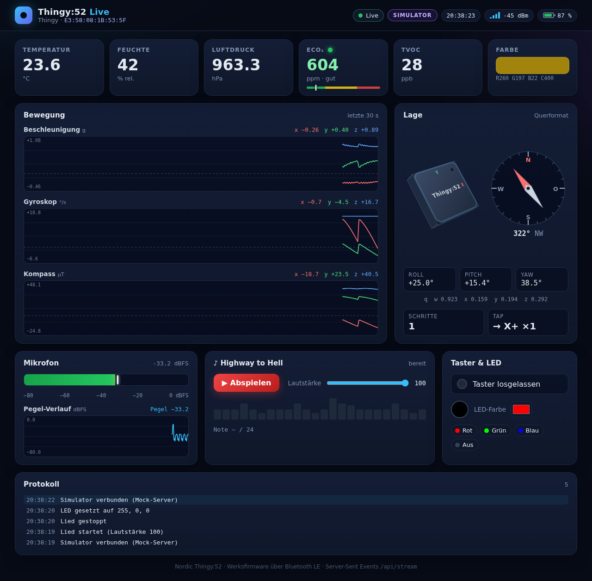
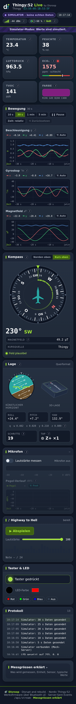
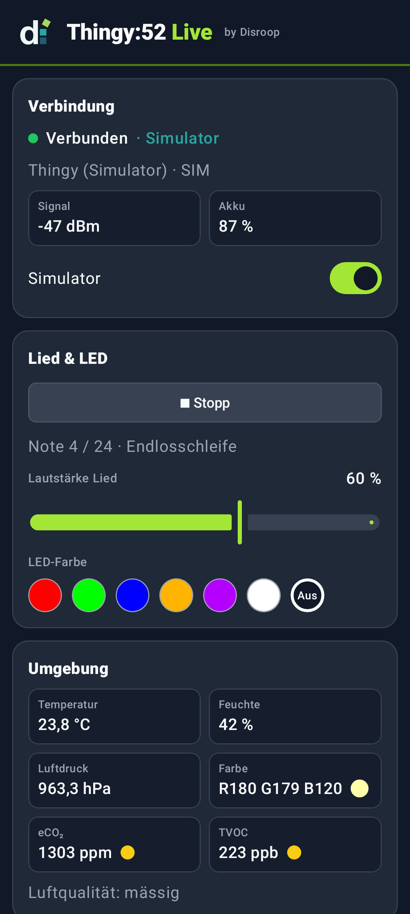
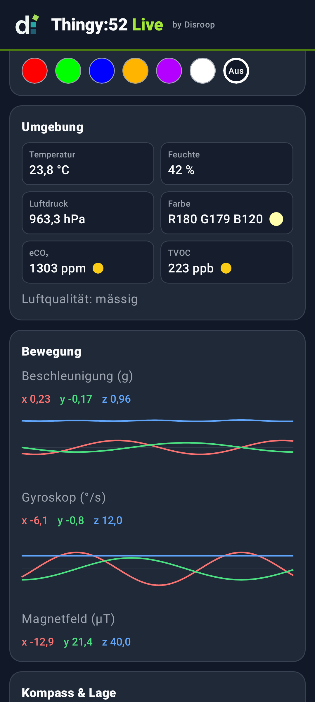
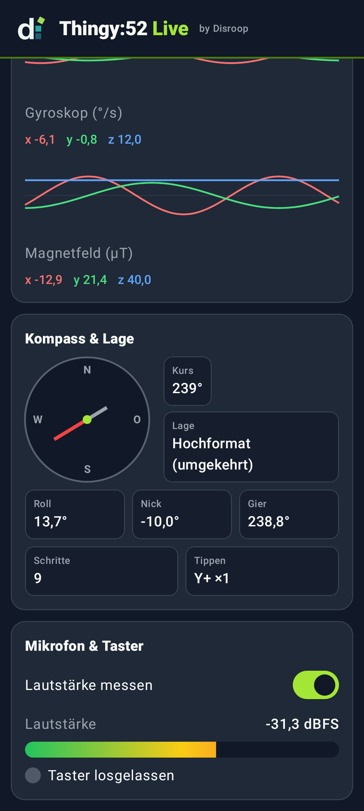
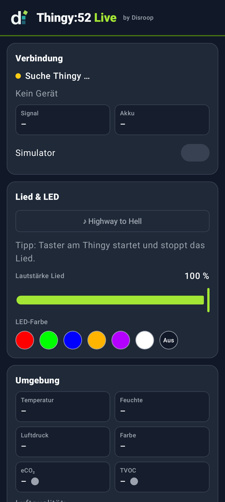

# Bedienung

Alle Befehle laufen im Repo-Ordner unter **WSL**. Builds und Tests laufen im Devcontainer-Image. `thingy.exe` selbst startet über WSL-Interop unter Windows.

## `./project`

| Befehl | Wirkung |
|---|---|
| `./project help` | Übersicht |
| `./project image` | Devcontainer-Image `disroop-sensor-playground-dev` neu bauen. Andere Befehle bauen es beim ersten Gebrauch automatisch. |
| `./project test` | alle Tests: bridge, web, android |
| `./project build` | `build/thingy.exe`, `build/thingy-linux` und `build/disroop-sensor-playground-debug.apk` |
| `./project run [args]` | wie `./project bridge run [args]` |

### `./project bridge …` ([scripts/bridge.sh](../scripts/bridge.sh))

| Befehl | Wirkung |
|---|---|
| `test` | `gofmt`, `go vet` und `staticcheck` (Linux + Windows), `go test -race`, danach `build` und `smoke` |
| `build` | `build/thingy.exe` (Windows amd64) und `build/thingy-linux` |
| `smoke` | `thingy-linux --sim` im Container starten und die HTTP-API sowie das Dashboard (headless Chromium) prüfen |
| `run [args]` | bauen und `thingy.exe [args]` auf Windows starten, z. B. `run --sim` |
| `scan [args]` | `thingy.exe scan`: Thingys in Reichweite auflisten |
| `song [args]` | `thingy.exe song`: verbinden und das Lied **einmal** spielen |
| `nfc [--restore]` | `thingy.exe nfc`: NFC-Tag umschreiben bzw. das Backup zurückschreiben |

`run`, `scan`, `song` und `nfc` bauen die exe vorher jedes Mal neu und starten sie im Repo-Ordner. Relative Pfade wie `build/nfc-backup.hex` zeigen deshalb ins Repo.

### `./project web …` ([scripts/web.sh](../scripts/web.sh))

| Befehl | Wirkung |
|---|---|
| `unit` | `node --test hardware/thingy-bridge/web/test/` |
| `smoke` | Mock-Server + headless Chromium: Live-Werte, Lied- und LED-Steuerung, keine JS-Fehler |
| `test` | `unit` + `smoke` |
| `serve` | Mock-Server mit Simulator auf http://localhost:8053. `PORT=…` ändert den Port, `Strg+C` stoppt. |
| `screenshot` | `build/dashboard.png` und `build/dashboard-mobile.png` |

### `./project android …` ([scripts/android.sh](../scripts/android.sh))

| Befehl | Wirkung |
|---|---|
| `test` | Unit-Tests `:protocol` und `:app` (inkl. Simulator-Smoke-Test) und Android-Lint |
| `build` | `assembleDebug` → `build/disroop-sensor-playground-debug.apk` |
| `screenshots` | Screenshots der App mit Simulator-Daten (Roborazzi/Robolectric, ohne Emulator) → `docs/img/android-*.png` |
| `badging` | Paket, SDK, Berechtigungen und Activity der APK anzeigen (`aapt2`) |
| `clean` | Gradle-Ausgaben löschen |

## `thingy.exe`

```
thingy [scan|song|nfc] [Optionen]
```

| Befehl | Wirkung |
|---|---|
| *(ohne)* | verbinden, Live-Ansicht im Terminal, Web-GUI auf http://localhost:8052, automatischer Reconnect |
| `scan` | Thingys auflisten (Adresse, RSSI, Name) |
| `song` | verbinden, „Highway to Hell“ einmal spielen, beenden |
| `nfc` | NFC-Tag auf die Android-App umschreiben (vorher Backup). Mit `--restore` wird das Backup zurückgeschrieben. |
| `help` | Hilfe, ebenso `--help` |

| Option | Standard | Bedeutung |
|---|---|---|
| `--sim` | aus | Simulator statt Bluetooth (für `nfc` mit eigenem Backup `build/nfc-backup-sim.hex`) |
| `--addr AA:BB:…` | leer | bestimmte Bluetooth-Adresse. Leer heisst: erster gefundener Thingy. |
| `--port N` | `8052` | HTTP-Port, lauscht nur auf `127.0.0.1` |
| `--no-tui` | aus | keine Live-Ansicht, nur Meldungen (z. B. für Logs) |
| `--volume N` | `100` | Lautstärke des Lieds, 0..100 |
| `--restore` | aus | `nfc`: Backup zurückschreiben |
| `--backup DATEI` | `build/nfc-backup.hex` | `nfc`: Backup-Datei (Hex) |
| `--timeout D` | `10s` | `scan`: Suchdauer |

Beispiele:

```bash
./project bridge run --sim --port 8060
./project bridge scan --timeout 20s
./project bridge song --volume 60 --addr E3:58:08:1B:53:5F
```

Direkt unter Windows (PowerShell, im Repo-Ordner): `.\build\thingy.exe --sim`

`Strg+C` beendet die exe sauber: Das Lied stoppt, die LED geht aus, die Verbindung wird getrennt.

### Terminal-Ansicht

```
Disroop Sensor Playground   Quelle: sim   Verbunden: ja   Web: http://localhost:8052

  Gerät           Thingy (Simulator)  SIM:00:00:00:00:52  RSSI -43 dBm
  Akku            62 %  ↑ lädt

  Beschleunigung  x  +0.01  y  +0.03  z  +1.01 g   |a| 1.01 g
  Drehrate        x   +1.0  y   +0.4  z   +0.3 °/s
  Kompass         x  +21.5  y   -6.0  z  +40.0 µT
  Kurs            48.2°
  Euler           Roll   +0.8°  Nick   -1.5°  Gier  +48.2°
  Lage            Hochformat
  Tippen          –
  Schritte        0

  Temperatur      23.4 °C
  Feuchte         41 %
  Luftdruck       963.2 hPa
  eCO₂ / TVOC     500 ppm  /  15 ppb
  Farbe           R 180  G 160  B 120  Hell 400

  Lautstärke       -21.0 dBFS [████████████████████████······]
  Taster          –
  LED             –
  Lied            gestoppt

  Meldungen:
    Verbunden mit Thingy (Simulator) (SIM:00:00:00:00:52)
```

## Web-Dashboard

Öffne http://localhost:8052, während `thingy.exe` läuft.


*Screenshot im Simulator-Modus (`thingy.exe --sim`), Disroop-Look.*

- **Kopfzeile:**
  - Gerätename und Adresse
  - Ein Status-Badge: `LIVE` (grün) bei echter Verbindung, `SIMULATOR` (violett, plus Banner) im Simulator-Modus
  - „Daten veraltet“, wenn 3 s lang nichts kommt
  - Zeit des letzten Werts, RSSI-Balken, Akku
  - Akku-Trend neben dem Akku: „⚡ lädt“ (lime), „Akkubetrieb“ oder dezent „?“. Der Trend ist aus dem Verlauf des Akkustands geschätzt, denn die Werksfirmware meldet den Ladestatus nicht.
- **Umgebung:** Temperatur, Feuchte, Luftdruck, eCO₂ mit Ampel (< 800 gut, < 1500 mässig, sonst schlecht), TVOC, Farbfeld mit RGBC-Rohwerten
- **Bewegung:** Diagramme für Beschleunigung (g), Gyroskop (°/s) und Magnetfeld (µT) mit Y-Achse samt Einheit, Zeitachse und Gitter. Alle Diagramme teilen dasselbe Zeitfenster.
  - Zeitfenster: 10 s, 30 s, 1 min oder 5 min
  - **Pause/Live** hält die Anzeige an. Die Daten laufen im Hintergrund weiter.
  - **Zeit:** schaltet die Achse zwischen relativ („−30 s … jetzt“) und Uhrzeit um
  - Mausrad oder Pinch zoomt die Zeitachse. Ziehen verschiebt das Fenster und pausiert dabei. Doppelklick oder **⟲ Zurücksetzen** kehrt zum gewählten Zeitfenster live zurück.
  - Fährst du mit der Maus oder dem Finger über ein Diagramm, zeigt ein Fadenkreuz Zeit und x/y/z.
  - Ein Klick auf die Legende blendet eine Kurve ein oder aus.
  - **Y: Auto/Fest** wählt zwischen automatischer und fester Skala.
- **Kompass:** Kursinstrument wie im Flugzeug: drehende Skala mit Strichen alle 5°/10°, Himmelsrichtungen (N, NO, O … NW) und Kurs-Spur.
  - **Kurs oben/Norden oben** schaltet die Ausrichtung um. Die Wahl wird gespeichert.
  - Grosse Kursanzeige, geglättet
  - Feldstärke in µT. Liegt sie ausserhalb von 25–65 µT, erscheint der Hinweis „Kompass kalibrieren“: Drehe das Thingy in einer 8er-Bewegung.
- **Lage:** künstlicher Horizont (Roll/Pitch), 3D-Würfel, Roll/Pitch/Yaw, Quaternion, Schritte, Tap-Richtung
- **Mikrofon:** Pegelanzeige in dBFS mit Peak und Pegel-Verlauf
- **Lied:** ▶/■ und Lautstärke-Regler. Die Noten werden während des Spielens hervorgehoben. Im Dashboard läuft das Lied in einer **Schleife** mit 1.5 s Pause, bis du es stoppst.
- **Taster & LED:** Tasterstatus, Farbwähler und die Presets Rot, Grün, Blau, Aus
- **Protokoll:** Meldungen der Bridge, z. B. Verbindungen und Fehler
- **ⓘ-Symbole:** Jede Karte und jedes Diagramm hat ein ⓘ. Antippen, Klicken oder Enter öffnet eine kurze Erklärung der Messgrösse mit Einheit, Sensor und typischen Werten. Esc schliesst sie. Der aufklappbare Abschnitt „Messgrössen erklärt“ am Seitenende zeigt alle Erklärungen als Tabelle. Siehe auch [MESSGROESSEN.md](MESSGROESSEN.md).

Mobile-Ansicht:



Die API (`/api/state`, `/api/stream`, `/api/song`, `/api/led`, `/healthz`) ist in [protocol.md §2](protocol.md#2-bridge-api-http-auf-1270018052-web-gui-und-smoke-tests) beschrieben. Aus WSL heraus:

```bash
curl.exe -s http://localhost:8052/api/state
curl.exe -s -X POST -H "Content-Type: application/json" -d '{"action":"play","volume":50}' http://localhost:8052/api/song
curl.exe -s -X POST -H "Content-Type: application/json" -d '{"r":255,"g":0,"b":0}' http://localhost:8052/api/led
```

## Lied und LED

- Das Lied besteht aus 24 Noten aus `hardware/shared/chorus.json`. Pro Note sendet die exe `[hz, on_ms, volume]` an den Lautsprecher (Frequenz-Modus).
- Die LED leuchtet während einer Note in einer Farbe je Tonhöhe (A = rot, 30° Farbton pro Halbton). In der Pause ist sie aus.
- **Starten und stoppen:**
  - Taster am Thingy (bei laufender `thingy.exe` oder App)
  - Knopf im Dashboard
  - `POST /api/song`
  - `./project bridge song`, das spielt das Lied einmal
- Die LED-Farbe setzt du über das Dashboard oder `POST /api/led`. Ohne Verbindung antwortet die API mit `503`.

## NFC: App per Handy-Tap öffnen

1. `thingy.exe` und die App trennen. Der Thingy erlaubt nur eine Verbindung.
2. `./project bridge nfc`:
   - Liest den aktuellen NDEF-Inhalt und speichert ihn **nur beim ersten Mal** nach `build/nfc-backup.hex`. Ein vorhandenes Backup bleibt unverändert.
   - Schreibt den Android Application Record `ch.disroop.sensorplayground` (39 Bytes), liest ihn zurück und prüft ihn.
3. App installieren, NFC am Handy einschalten und das Handy an den Thingy halten. Die App öffnet sich und verbindet sich per BLE.
4. Ursprünglichen Inhalt wiederherstellen (Nordic-Thingy-App): `./project bridge nfc --restore`

> `build/` ist nicht im Git. Bewahre `build/nfc-backup.hex` auf, falls du den Originalzustand wieder willst.

## Android-App

   

*Simulator-Modus: Live-Werte, Bewegung, Kompass & Mikrofon. Rechts: Die App sucht einen Thingy.*

- **Start:** über das App-Icon „Sensor Playground“ oder per NFC-Tap am Thingy. Beim ersten Start erlaubst du „Geräte in der Nähe“. Unter Android ≤ 11 heisst die Berechtigung „Standort“.
- **Verbinden:** Die App scannt und verbindet sich mit dem **nächsten** Thingy, also dem mit dem stärksten Signal. Bei Abbruch verbindet sie sich automatisch neu.
- **Hintergrund:** Geht die App in den Hintergrund, trennt sie die Verbindung. Der Thingy ist dann wieder frei für `thingy.exe`.
- **Karten:**
  - Verbindung mit Signal und Akku, darunter „lädt ↑“, „Akkubetrieb ↓“ oder „Ladezustand unbekannt“ (geschätzt), Schalter **Simulator**
  - Lied & LED
  - Umgebung mit Luftqualität
  - Bewegung (Verläufe)
  - Kompass & Lage
  - Mikrofon & Taster
- **Lied:** spielt in der App **einmal** durch, der Taster am Thingy startet und stoppt es.
- **Kein Bluetooth/keine Berechtigung:** Die App zeigt einen Knopf „Bluetooth einschalten“ bzw. „Berechtigung erteilen“.
- Installation: siehe [README](../README.md#android-app-installieren) und [hardware/android/README.md](../hardware/android/README.md).

## Thingy aufwecken

Nach einigen Minuten ohne Verbindung schläft der Thingy und sendet kein Advertising mehr. Zum Aufwecken **Knopf drücken** (Taster oben auf dem Gehäuse) oder **schütteln**. `thingy.exe` sucht während des Schlafs weiter und meldet „Thingy nicht gefunden – Taste drücken oder schütteln, um es zu wecken“.
