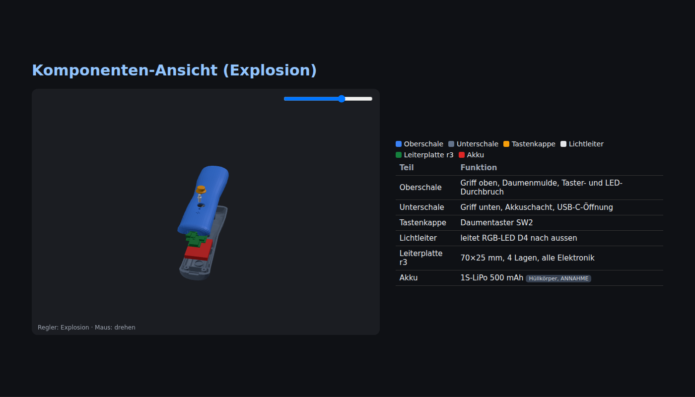

# Disroop Motion One

Ein geplanter Einhand-Motion-Controller für Tennis und Ski. Das Gerät soll das Thingy:52-BLE-Profil nachbilden, damit
Bridge, Spiele und Android-App ohne Codeänderungen funktionieren.

> **▶ Überblick in 5 Minuten:** [Technische Präsentation – Zwischenbericht r3](https://stefaneicher.github.io/disroop-sensor-playground/hardware/motion-one/media/presentation/ZWISCHENBERICHT_2026-11-08_r3.html)
> (Funktionen, 3D-Ansicht zusammengebaut und als Explosion, Komponenten, Preis, Design-Herleitung). Läuft direkt im Browser (GitHub Pages).

## Aktueller Stand

V1 ist ein **digitaler Entwicklungsstand**, noch kein fertiges oder geprüftes Produkt: PCB, Firmware und ergonomisches
Gehäuse liegen als Entwürfe vor. Die Schnittstellen werden gerade integriert. Es wurde nichts bestellt, bezahlt,
gedruckt, geflasht oder unter Spannung gesetzt; Hardwaretests sind NOT RUN. Der detaillierte Status und die nächsten
Schritte stehen im [Motion-One-Resume](management/RESUME.md).

## Themen

| Bereich | Kurzfassung | Status |
|---|---|---|
| [Elektronik / PCB](electronics/README.md) | KiCad-Board, Schaltplan, SPICE-Analyse und Pinout | Entwurf; finale Mechanik-Abstimmung offen |
| [Firmware](firmware/README.md) | Zephyr-Firmware mit Thingy-Profil, Bewegungserfassung und UF2-Programmierweg | 32/32 Host-Tests; echtes Pinout wird integriert |
| [Mechanik](mechanics/README.md) | Parametrisches, beidhändig nutzbares Griffgehäuse, FEM und 3D-Druck | CAD und Slicer-Daten vorhanden; PCB-Abgleich offen |
| [Fertigung](manufacturing/README.md) | PCBA-Uploadpaket und Slicer-Ausgaben | Dateien vorbereitet; noch kein Auftrag oder Druck |
| [Beschaffung](sourcing/README.md) | BOM, Lagerabfragen und Bestücker-Vergleich | Momentaufnahme; finale Versand- und PCBA-Angebote offen |

## Projektdateien

- [Entwicklungsprompt](PROMPT_1_ENTWICKLUNG.md) und [Marktauftritt-Prompt](PROMPT_2_MARKTAUFTRITT.md)
- [Technische Präsentation (Zwischenbericht r3)](https://stefaneicher.github.io/disroop-sensor-playground/hardware/motion-one/media/presentation/ZWISCHENBERICHT_2026-11-08_r3.html)
- [Vorab-Check](PREFLIGHT.md) und [Vorbildanalyse](ANALYSE.md)
- [Hauptprotokoll](../../docs/protocol.md)

Alle Masse, Preise und Leistungswerte sind Quellenangaben, Berechnungen, Simulationen oder Annahmen; Details und
Belegpfade stehen in den jeweiligen Bereichs-README-Dateien und Handoffs. CE/RED, FCC, UN38.3, EMV und physische
Sicherheit sind nicht validiert.
