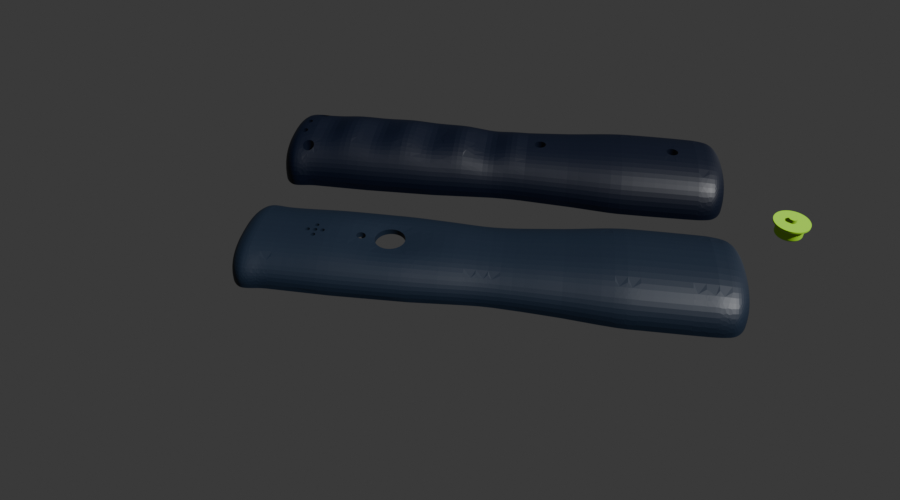

# Mechanik

Parametrisches CAD für ein ergonomisches Einhandgehäuse mit zweiteiliger Schale, Daumentaster, Lichtleiter, USB-C-
Ausschnitt, Akkuhalterung, Summeröffnung und Vibrationsmotorhalter.

## Stand

Das V1-Design ist ein beidhändig nutzbarer, taillierter Griff mit Fingerwellen und Daumenmulde. CAD-Teile, STEP,
STL/3MF, Toleranzkörper und PETG-Slicerprojekt sind erzeugt; Gehäusezeit laut Slicer 3 h 56 min und 71,6 g Material
(SIMULATION, nicht gemessener Druck). Ergonomie und Passungen sind nicht physisch getestet.



*CAD-Render der Gehäuseteile, kein Foto eines gedruckten oder montierten Geräts. Geometrie und Board-Schnittstellen
werden in der laufenden Integration noch geprüft.*

FEM-Vergleich der Varianten liegt vor, aber die Netzkonvergenz ist PARTIAL: die Netze wurden aus STL statt einer
gültigen BREP-Geometrie erzeugt. Auch die Kollisionen müssen gegen die finale PCB-Revision erneut geprüft werden.
Keine Behauptung über Fallfestigkeit oder Produktsicherheit ist dadurch belegt.

## Wichtige Dateien

- `../scripts/mechanics/params.py`: zentrale Parameter (mm) und markierte Annahmen
- `cad/`: Gehäuse-STEP und CAD-Ergebnisse
- `fem/`: Netze, FEM-Modelle und Ergebnisdaten
- `print/`: Druckorientierte STL/3MF und Slicer-Ergebnisse
- `renders/`: Vorschau der Druckteile
- `../manufacturing/print/`: vorbereitete Bambu-Studio-Druckprojekte

## Reproduzieren

```sh
./project hw run "python3 hardware/motion-one/scripts/mechanics/build_enclosure.py"
```

Der finale Schnittstellenvertrag steht in `../management/INTERFACES.json`. Nach Boardänderungen CAD-Bau, Kollisions-
prüfung und Slice erneut ausführen. Erst den Toleranzkörper drucken und Spiel messen, bevor das Gehäuse gedruckt wird.
