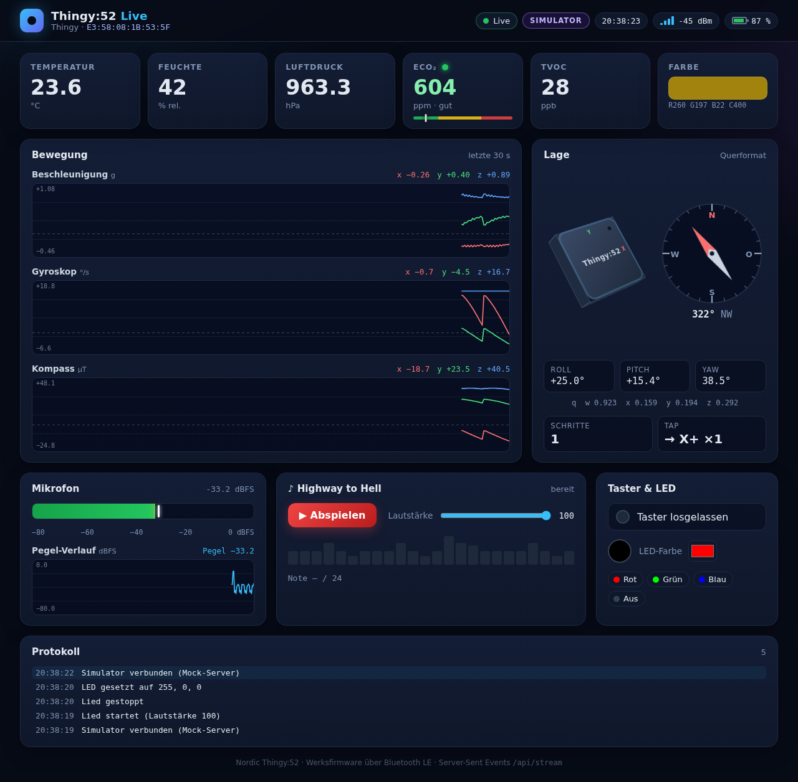

# hardware/thingy-bridge/web – Web-Dashboard

Das Live-Dashboard für http://localhost:8052 besteht aus HTML, CSS und ES-Modulen **ohne Build-Step** und ohne npm-Abhängigkeiten. `thingy.exe` bettet es per `go:embed` ein ([embed.go](embed.go)).



## Befehle

```bash
./project web unit         # node --test hardware/thingy-bridge/web/test/
./project web smoke        # Mock-Server + headless Chromium
./project web test         # unit + smoke
./project web serve        # Mock-Server mit Simulator: http://localhost:8053 (PORT=… ändert den Port)
./project web screenshot   # build/dashboard.png, build/dashboard-mobile.png
```

Gegen die echte Bridge: `./project bridge run --sim` und http://localhost:8052 öffnen. Der Bridge-Smoke-Test (`./project bridge smoke`) lässt `dev/smoke.js --url` auch gegen `thingy-linux --sim` laufen.

## Aufbau

```
static/index.html, styles.css   Seite (Deutsch, dunkles Theme, responsive)
static/js/
  app.js            Einstieg: verdrahtet SSE, Reducer, Charts, Bedienelemente
  connection.js     EventSource mit Reconnect (backoff.js: 0.5 s … 10 s)
  state.js          reiner Reducer: Verbindung, Snapshot, Log, „veraltet“ nach 3 s
  view.js           dünne DOM-Schicht
  time-chart.js     Canvas-Zeitdiagramm (Achsen, Fadenkreuz, Zoom/Pan, Legende, Y Auto/Fest)
  chart-group.js    gemeinsames Zeitfenster + rAF-Schleife; chart-toolbar.js Bedienleiste
  axis.js           „schöne“ Achsen-Ticks, Zeit-Ticks; timefmt.js Zeitbeschriftung
  timewindow.js     Zeitfenster-Mathematik (Zoom, Pan, Pause/Live, Presets)
  series.js         Ringpuffer (typed arrays, 5 min); decimate.js Min/Max-Dezimierung
  heading.js        Kurs: Glättung (Kreismittel), Kippkompensation, Feldqualität, Skala
  compass-view.js   Kursinstrument (SVG); attitude-view.js künstlicher Horizont (SVG)
  format.js         Zahlen/Einheiten, fehlende Werte als „–“
  classify.js       eCO₂-Ampel, Akku-Stufe/-Trend, RSSI-Balken
  orientation.js    3D-Würfel (Quaternion/Euler → CSS matrix3d), Roll/Pitch für den Horizont
  level.js          Pegel-Peak, color.js Farben, chorus.js Noten (Spiegel von hardware/shared/chorus.json)
  throttle.js, api.js   Drosselung, POST /api/song und /api/led
test/*.test.js      node --test, ein Test pro Logikmodul + Mock-Server + Simulator
dev/
  sim.js            deterministischer Simulator (Snapshots wie hardware/shared/telemetry.example.json)
  mock-server.js    Stand-in für die Bridge-API (§2 in docs/protocol.md)
  smoke.js          headless Chromium über CDP (cdp.js), --url, --screenshot
```

## Regeln

- Alle Entscheide stecken in **reinen Modulen** mit Tests. `view.js`, `time-chart.js`, `compass-view.js` und `attitude-view.js` schreiben nur ins DOM bzw. Canvas.
- Die Daten kommen ausschliesslich über die API aus [docs/protocol.md](../../../docs/protocol.md#2-bridge-api-http-auf-1270018052-web-gui-und-smoke-tests). Das Snapshot-Format ist [docs/telemetry.schema.json](../../../docs/telemetry.schema.json). Fehlende Werte sind `null` und werden als „–“ angezeigt.
- Änderst du `hardware/shared/chorus.json`, musst du auch `static/js/chorus.js` anpassen. `test/chorus.test.js` prüft, dass beide übereinstimmen.
