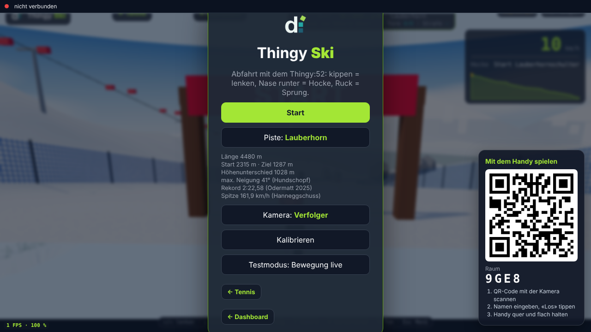
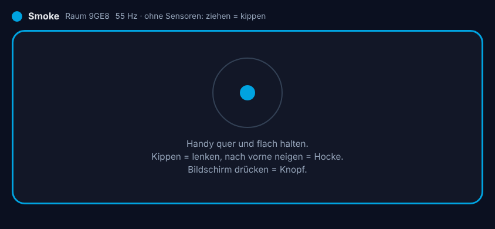

# relay – Handy als Controller

Kleiner Go-Server, der Handys mit dem Spielbildschirm verbindet. Der Bildschirm zeigt einen QR-Code, das Handy
öffnet die Pad-Seite und schickt seine Bewegung als `MotionFrame` (dasselbe Format wie der Thingy, siehe
[docs/protocol.md](../docs/protocol.md)). Konzept: [docs/KONZEPT_HANDY_CONTROLLER.md](../docs/KONZEPT_HANDY_CONTROLLER.md).

```
Spiel (Browser) ──wss /ws/screen──▶ relay ◀──wss /ws/pad?room=K7Q2── Handy (/games/pad/)
       ◀── room, join, leave, frame ──      ── welcome, feedback ──▶
```

 

*Bildschirm mit QR-Code und Pad-Seite im Querformat (Screenshots aus `games/dev/relay-smoke.js`).*

Das Relay liefert auch die Website aus (Konsole, Spiele, Pad), damit Bildschirm und Handy denselben Server
nutzen. Die Spiele können aber auch woanders laufen (GitHub Pages, `thingy.exe`): `?relay=<host>` in der URL.

## Starten

```bash
./project relay test     # Go-Tests + Smoke (headless Chromium: Bildschirm, QR, Pad tritt bei, Frames kommen an)
./project relay image    # Docker-Image disroop-relay (Spiele + Pad + Server)
./project relay run      # http://localhost:8080
```

Dann im Browser öffnen: `http://localhost:8080/games/ski/?relay=same` (oder `/games/?relay=same` für Tennis).
Der QR-Code zeigt auf `https://<relay>/games/pad/?room=CODE`.

**Handys geben Bewegungssensoren nur über HTTPS frei.** Für einen schnellen Test mit dem echten Handy reicht ein
Tunnel, der HTTPS davorsetzt, z. B.:

```bash
cloudflared tunnel --url http://localhost:8080   # gibt eine https://….trycloudflare.com-Adresse aus
```

Diese Adresse auf dem Laptop öffnen (`…/games/ski/?relay=same`), QR-Code mit dem Handy scannen. Ohne Sensoren
(Desktop, Freigabe abgelehnt) steuert Ziehen auf dem Pad.

## Optionen

| Flag | Standard | Bedeutung |
|---|---|---|
| `-addr` | `:8080` | Adresse |
| `-static` | leer | Ordner mit der Website (`sh scripts/site.sh build/site`) |
| `-ttl` | `30m` | Räume ohne Verkehr werden danach geschlossen |
| `-max-pads` | `24` | Handys pro Raum |
| `-tls-cert`, `-tls-key` | leer | TLS direkt im Relay (z. B. Messe-Router mit eigenem Zertifikat) |

## Protokoll

JSON-Nachrichten über WebSocket.

| Richtung | Nachricht |
|---|---|
| Relay → Bildschirm | `{"type":"room","room":"K7Q2"}` nach dem Verbinden |
| Relay → Bildschirm | `{"type":"join","pad":1,"name":"Mia","color":"#00a3e0"}`, `{"type":"leave","pad":1}` |
| Relay → Bildschirm | `{"type":"frame","pad":1,"f":{MotionFrame}}` – die Pad-Nummer setzt das Relay |
| Bildschirm → Relay | `{"type":"feedback","pad":1,"kind":"hit"}` (pad 0 = alle) |
| Relay → Pad | `{"type":"welcome","room":"K7Q2","pad":1,"name":"Mia","color":"#00a3e0"}`, `{"type":"feedback","kind":"hit"}`, `{"type":"error","text":"unbekannter Raum"}` |
| Pad → Relay | `{"type":"frame","f":{MotionFrame}}` mit etwa 60 Hz |

HTTP: `GET /healthz`, `GET /api/status` (`{"rooms":n,"pads":n}`), `GET /api/relay` (Erkennung «Seite kommt vom Relay»).

**Bewusst einfach:** keine Konten, keine Datenbank, Ranglisten bleiben im Spiel. Räume verschwinden mit dem
Bildschirm oder nach `-ttl`. Volle Sendepuffer verwerfen Frames, statt zu blockieren (frische Frames sind wichtiger
als vollständige).

## Offen

Hosting mit eigener Domain, Deploy aus GitHub Actions, Betrieb: siehe [docs/KONZEPT_LANDSCHAFT.md](../docs/KONZEPT_LANDSCHAFT.md).
Mehrspieler (Skicross) nutzt dasselbe Protokoll: Der Bildschirm bekommt die Frames aller Pads mit ihrer Nummer.
